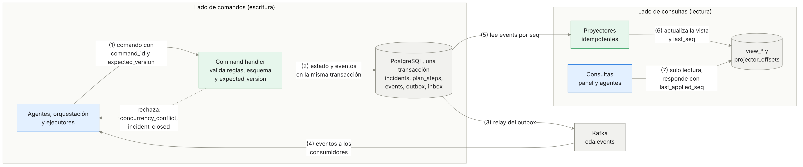
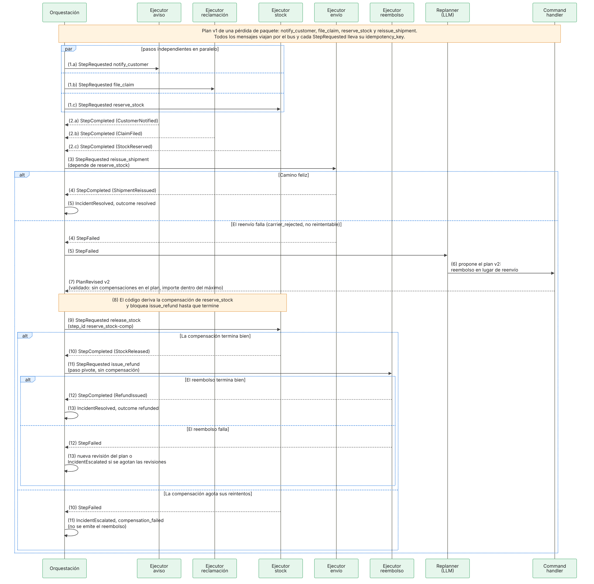

# Diseño técnico de la PoC EDA (incidencias logísticas)

Complementa las specs de `specs/`. Aquí se concreta cómo materializa la pila cada concepto de las specs. Si una decisión de este documento contradice una spec, manda la spec y hay que corregir uno de los dos.

## 1. Pila

| Pieza | Decisión | Motivo |
| --- | --- | --- |
| Lenguaje | Python 3.12 | Decidido |
| Broker | Apache Kafka (imagen `apache/kafka`, KRaft, un solo broker) en Docker | Decidido |
| Base de datos | PostgreSQL 16 en Docker, con volumen persistente | Decidido |
| Cliente Kafka | `confluent-kafka` | Estable, usa librdkafka, permite commit manual de offsets |
| Cliente PostgreSQL | `psycopg` 3 | Transacciones explícitas y `SKIP LOCKED` |
| Migraciones | `db/init/001_schema.sql` al crear el volumen; Alembic si el esquema empieza a cambiar | Empezar simple |
| Esquemas de eventos | `pydantic` | Validación de las salidas del LLM y de los eventos |
| LLM | SDK de Anthropic, detrás de una interfaz `LlmClient` con una implementación simulada para tests | Permite ejecutar los experimentos sin coste y con datos deterministas |
| Tests | `pytest`, con PostgreSQL y Kafka reales en Docker para los de integración | Las garantías (inbox, outbox) solo se prueban con la base real |

## 2. Dónde vive cada concepto de las specs

| Concepto de la spec | Materialización |
| --- | --- |
| Log de eventos (fuente de verdad) | Tabla `events` de PostgreSQL, solo de añadir (triggers que rechazan `UPDATE`, `DELETE` y `TRUNCATE`) |
| Outbox | Tabla `outbox` (una fila por evento, con `published_at`) escrita en la misma transacción que el estado y `events` |
| Bus | Topic `eda.events` de Kafka, 3 particiones, clave `incident_id`, retención infinita |
| Dead letter queue | Topic `eda.dlq` y tabla `dead_letters` |
| Inbox | Tabla `inbox (consumer, event_id)` |
| Almacén de claves de idempotencia | Tabla `effect_keys` |
| Estado del command handler | Tablas `incidents`, `plan_steps`, `carrier_notices` |
| Vistas CQRS | Tablas `view_*` y `projector_offsets` |
| Comandos | Peticiones internas al command handler, con `command_id` y `expected_version` |
| Saga | Estado de los pasos en `plan_steps` (incluye `compensating` y `compensated`); compensaciones derivadas por la orquestación |
| Negocio simulado | Tablas `orders`, `stock`, `reservations`, `claims`, `refunds`, `customer_messages` |

La tabla `events` es inmutable, por eso el estado de publicación vive aparte en `outbox`. Kafka no es la fuente de verdad: si se pierde un topic, el relay lo republica desde `events`.

## 3. Componentes y grupos de consumidores

Cada componente es un proceso Python independiente con su propio `group.id` en Kafka y su propio nombre de consumidor en el inbox.

| Componente | Consume | Produce | Tipo |
| --- | --- | --- | --- |
| `interpreter` | `CarrierNoticeReceived` | `ShipmentDelayed` | LLM + command handler |
| `planner` | `ShipmentDelayed` | `PlanCreated` | LLM + command handler |
| `orchestrator` | `PlanCreated`, `PlanRevised`, `StepCompleted`, `StepFailed` | `StepRequested`, `IncidentResolved`, `IncidentEscalated` | Código |
| `replanner` | `StepFailed` | `PlanRevised` | LLM + command handler |
| `executor-<acción>` (uno por acción) | `StepRequested` de su acción | `StepCompleted`, `StepFailed` y el evento de efecto | Código (el redactor se invoca desde aquí) |
| `projectors` | todos, leyendo de `events` por `seq` | Vistas | Código |
| `relay` | tabla `outbox` | Mensajes a Kafka | Código |

Todos los eventos viajan por un único topic con el `event_type` en una cabecera del mensaje. Cada consumidor ignora los tipos que no le interesan (el inbox solo registra los que procesa).

## 4. Flujo de escritura: command handler y outbox

Toda escritura de un componente es una sola transacción de PostgreSQL:

```
BEGIN
  1. INSERT INTO inbox (consumer, event_id) ON CONFLICT DO NOTHING
       -> si no inserta fila: COMMIT, confirmar offset, terminar (duplicado)
  2. validar la propuesta (esquema, reglas de negocio, presupuesto)
  3. actualizar el estado de escritura (incidents, plan_steps...)
  4. INSERT INTO events (...)   -- uno o varios
  5. INSERT INTO outbox (seq)   -- uno por evento
COMMIT
confirmar el offset en Kafka
```

La llamada al LLM se hace **antes** de la transacción: la propuesta llega ya generada. Si el proceso cae entre la llamada y el `COMMIT`, el evento se reentrega y se repite la llamada. Cuesta tokens, pero no provoca efectos duplicados.

### 4.1 CQRS: comandos, versión y consultas

El command handler es una librería interna (no un servicio HTTP). Los componentes le envían los comandos del catálogo de `docs/README.md` y él decide.

- **Versión de concurrencia:** `incidents.version`. Cada comando indica `expected_version`; el handler hace `UPDATE incidents SET version = version + 1 WHERE incident_id = ? AND version = ?`. Si no actualiza ninguna fila, rechaza con `concurrency_conflict` y no escribe eventos. El componente reintenta leyendo el estado actual.
- **Sin event sourcing puro:** el estado de escritura (`incidents`, `plan_steps`) se guarda en tablas y se actualiza en la misma transacción que `events` y `outbox`. El log permite reconstruir las vistas y auditar, pero no se rehidrata el estado de escritura a partir de él.
- **Consultas:** módulo `queries/` que solo lee tablas `view_*`. Cada respuesta incluye `last_applied_seq` del proyector correspondiente (de `projector_offsets`). Los agentes que necesiten el estado de la incidencia para decidir lo consultan aquí, y los que validan una escritura usan el command handler.



### 4.2 Saga: operaciones y compensaciones

La orquestación gobierna la saga. La categoría de cada acción y su compensación están en código (tabla en `specs/incident-planning`):

| Acción | Compensación | Notas |
| --- | --- | --- |
| `notify_customer` | Ninguna | |
| `file_claim` | Ninguna | La reclamación sigue siendo válida aunque se reembolse |
| `reserve_stock` | `release_stock` | Única acción compensable |
| `reissue_shipment` | Ninguna | |
| `issue_refund` | Ninguna | Paso pivote: se emite el último y solo sin compensaciones pendientes |

Al recibir un `PlanRevised`, la orquestación, en una transacción:
1. Marca como `cancelled` los pasos pendientes que el plan nuevo no mantiene.
2. Para cada paso `completed` compensable cuyo dependiente se ha cancelado, inserta un paso con `step_id = <original>-comp` y `compensates = <original>`, lo marca `compensating` en el original y emite su `StepRequested`.
3. Retiene `issue_refund` hasta que no queden pasos `compensating`.

Las compensaciones se ejecutan en orden inverso a los pasos originales y usan la misma maquinaria de idempotencia (`effect_keys`) que cualquier otro paso. Si una compensación agota sus reintentos, la incidencia se escala con `compensation_failed`.



## 5. Relay del outbox

Proceso con polling, sin Debezium:

```
loop:
  BEGIN
    SELECT o.seq, e.* FROM outbox o JOIN events e USING (seq)
    WHERE o.published_at IS NULL
    ORDER BY o.seq LIMIT 100
    FOR UPDATE OF o SKIP LOCKED
    producir los mensajes a eda.events (clave = correlation_id) y esperar la confirmación
    UPDATE outbox SET published_at = now() WHERE seq IN (...)
  COMMIT
  si no hay filas: dormir un intervalo corto (p. ej. 100 ms)
```

Garantías y límites:
- **Al menos una vez:** si el relay cae tras producir y antes del `COMMIT`, republica. Los duplicados los absorbe el inbox.
- **Orden por incidencia:** el relay lee por `seq` y Kafka conserva el orden dentro de una partición. Con varios relays concurrentes, `SKIP LOCKED` puede intercalar lotes; para la PoC se ejecuta **un solo relay**, que es suficiente y mantiene el orden.
- **Republicación:** `relay --replay-from <seq>` marca como no publicadas las filas desde `seq` y las vuelve a enviar (útil si se pierde el topic).

## 6. Consumidores: inbox y confirmación del offset

```
poll mensaje de Kafka (enable.auto.commit = false)
validar esquema; si es inválido -> eda.dlq + dead_letters, confirmar offset
procesar en una transacción (sección 4)
confirmar el offset solo tras el COMMIT
```

- Si el consumidor cae después del `COMMIT` y antes de confirmar el offset, Kafka reentrega y el inbox lo descarta.
- Si falla antes del `COMMIT`, no se confirma el offset y se reintenta con backoff exponencial y jitter. Agotados los reintentos, el mensaje va a la dead letter queue y, si pertenece a una incidencia abierta, el sistema publica `IncidentEscalated`.

## 7. Ejecutores: inbox y `effect_keys`

El inbox evita procesar dos veces un evento. `effect_keys` evita ejecutar dos veces un efecto. Un `StepRequested` nuevo puede pedir un efecto ya ejecutado, y el segundo mecanismo lo para.

```
BEGIN
  inbox (como en la sección 4)
  INSERT INTO effect_keys (key, ..., status='in_progress', locked_until = now() + plazo)
     ON CONFLICT DO NOTHING
  si no inserta fila:
     leer la clave existente
       completed    -> reutilizar el resultado, sin repetir el efecto
       in_progress y locked_until > now() -> reintentar más tarde (no confirmar offset)
       in_progress y locked_until <= now() -> tomar el relevo y ejecutar
  ejecutar el efecto
     simulado en PostgreSQL -> en esta misma transacción (garantía fuerte)
     externo simulado (correo, transportista) -> con la misma clave hacia el servicio simulado
  UPDATE effect_keys SET status='completed', result=...
  INSERT events (StepCompleted + evento de efecto) + outbox
COMMIT
```

Restricciones de unicidad que refuerzan la idempotencia incluso sin `effect_keys`: `claims (incident_id, order_id)`, `refunds.step_id`, `customer_messages.step_id`. Para la variante «sin idempotencia» del experimento E1 se desactivan `INBOX_ENABLED` y `EFFECT_KEYS_ENABLED` y, en la base de pruebas, se eliminan también estas restricciones, para medir los duplicados reales.

## 8. Proyectores

Cada proyector lee de `events` por `seq` (no de Kafka), así la reconstrucción no depende de la retención del broker:

```
BEGIN
  SELECT * FROM events WHERE seq > last_seq ORDER BY seq LIMIT 500
  aplicar los eventos a la vista (idempotente)
  UPDATE projector_offsets SET last_seq = <último seq aplicado>
COMMIT
```

Reconstruir una vista = vaciar sus tablas `view_*` y poner `last_seq = 0`. Los proyectores no usan el inbox: su posición está en `projector_offsets`, que se actualiza en la misma transacción que la vista.

## 9. Kafka: configuración

| Parámetro | Valor | Motivo |
| --- | --- | --- |
| Topic `eda.events` | 3 particiones, retención infinita | Orden por `incident_id`, reproducción posible |
| Topic `eda.dlq` | 1 partición, retención infinita | Revisión manual |
| Productor (relay) | `enable.idempotence=true`, `acks=all` | Sin duplicados por reintentos del productor |
| Consumidor | `enable.auto.commit=false`, `auto.offset.reset=earliest` | Commit tras el `COMMIT` de PostgreSQL |
| Garantía de entrega | Al menos una vez, sin transacciones de Kafka | Los duplicados los resuelven inbox y `effect_keys` |

## 10. Estructura propuesta del repositorio

```
eda-retail/
  specs/                  specs OpenSpec y diagrama
  design.md               este documento
  docker-compose.yml      Kafka y PostgreSQL
  db/init/001_schema.sql  esquema
  .env.example
  pyproject.toml
  src/eda_retail/
    config.py
    events/               modelos pydantic y catálogo de eventos
    infra/                db.py (psycopg), kafka.py, outbox.py (relay), inbox.py, effect_keys.py
    llm/                  cliente real y simulado, validación de salidas
    agents/               interpreter.py, planner.py, replanner.py, writer.py
    command/              command handler y reglas de negocio
    orchestrator/         orquestación del plan
    executors/            un módulo por acción
    projectors/           una vista por módulo
    synthetic/            generador de avisos e inyección de fallos
    baseline_sync/        base síncrona para E6
  experiments/            E1 a E7 con informe
  tests/                  unitarios e integración
```

## 11. Arranque local

```
cp .env.example .env
docker compose up -d      # PostgreSQL con el esquema, Kafka y los topics
docker compose ps         # postgres y kafka deben estar healthy
```

El proyecto de compose se llama siempre `eda-retail` (`name:` en `docker-compose.yml`): los contenedores tienen nombre fijo (`eda-kafka`, `eda-postgres`…), así que un git worktree en otra carpeta ve y usa los mismos contenedores en lugar de intentar crear otros con el mismo nombre. `docker compose down` conserva los datos de ambos volúmenes; `docker compose down -v` los borra y vuelve a crear el esquema en el siguiente arranque.

## 12. Estado de la verificación

- El esquema SQL se ha ejecutado contra PostgreSQL 16 (incluida la columna `version` y los estados de compensación): las tablas se crean, `UPDATE`, `DELETE` y `TRUNCATE` sobre `events` se rechazan, y el inbox y `effect_keys` ignoran las inserciones duplicadas.
- `docker-compose.yml` se ha ejecutado (2026-11-13): `kafka` y `postgres` quedan `healthy` y `kafka-init` crea `eda.events` (3 particiones) y `eda.dlq` (1 partición) con retención infinita. En el primer arranque falló la creación de topics porque el broker solo anunciaba `localhost:9092`, que dentro de otro contenedor apunta a sí mismo; ahora hay dos listeners: `INTERNAL` (`kafka:19092`, para contenedores) y `EXTERNAL` (`localhost:9092`, para los procesos del host).

## 13. Observabilidad: OpenTelemetry y Jaeger

Trazas distribuidas con OpenTelemetry (OpenTracing está archivado y se fusionó en OpenTelemetry), exportadas por OTLP/HTTP a Jaeger (`jaeger` en `docker-compose.yml`, interfaz en http://localhost:16686, almacenamiento en memoria).

| Tipo | Qué se traza | Cómo |
| --- | --- | --- |
| Asíncrono | Escritura del evento → relay → Kafka → consumidor → eventos derivados, en una sola traza por incidencia | Span `<event_type> create` al escribir; su contexto W3C (`traceparent`) se guarda en `outbox.trace_context`; el relay abre `<event_type> publish` como hijo y lo pone en las cabeceras del mensaje; el consumidor abre `<event_type> process` como hijo de esas cabeceras |
| Síncrono | Cada sentencia SQL y las operaciones en proceso | Instrumentación de psycopg en `infra/db.connect` y decorador `@traced` |

- El contexto va en `outbox` y no en `events`: el log no cambia, y la republicación (`--replay-from`) conserva la traza original.
- Atributos de cada span: `eda.incident_id` (= `correlation_id`), `eda.event_id`, `eda.causation_id`, `eda.event_type`, `eda.producer`; los de consumo añaden `eda.outcome` (`processed`, `duplicate`) y los datos de Kafka. En Jaeger se busca una incidencia con el tag `eda.incident_id`.
- Las sentencias SQL sin operación en curso (el polling del relay) no se trazan: el sampler descarta los spans CLIENT sin padre.
- Configuración: `TRACING_ENABLED` (por defecto `true`) y `OTEL_EXPORTER_OTLP_ENDPOINT` (por defecto `http://localhost:4318`). Sin Jaeger el sistema funciona; solo se pierden las trazas.
- Cada proceso llama a `setup_tracing("<componente>", settings)` al arrancar; el componente es el `service.name` en Jaeger.
- Esquema: `outbox.trace_context` llega con la migración `0002` de Alembic. Tras `docker compose up -d`, aplicar las migraciones con `uv run alembic upgrade head` (la revisión `0001` no hace nada si el volumen ya tiene el esquema de `db/init/001_schema.sql`).
- Demo: `uv run python scripts/trace_demo.py` lanza aviso → intérprete → planificador en procesos separados (base `eda_demo`, topic `eda.trace-demo`) e imprime la URL de la traza.

## 14. Front web

Interfaz local para operar y observar la PoC (spec `web-front`): un backend FastAPI (`src/eda_retail/web/`, comando `eda-web`) y un front React + Vite (`web/`). Se arranca con `scripts/run-web.sh`.

| Parte | Cómo |
| --- | --- |
| Acceso | `eda-web` escucha solo en `127.0.0.1`; `LocalOriginGuard` rechaza Host y Origin que no sean de localhost (DNS rebinding). Lee PostgreSQL con `default_transaction_read_only=on`: el front nunca escribe en el log ni salta el command handler |
| Eventos | `GET /api/events` pagina `events` por `seq` y añade, de `outbox`, el contexto de traza y la partición y el offset que guardó el relay (migración `0007`). `GET /api/events/stream` es SSE: sondea cada 0,5 s tras el último `seq` enviado y reanuda con `Last-Event-ID` |
| Emisor y destino | Emisor = `producer`. Destino = los componentes que declaran ese tipo de evento (`agents.cli.AGENTS`, `orchestrator.runner.EVENT_TYPES`, `executor-<acción>` para `StepRequested`), con los proyectores siempre al final |
| Mapa | Topología estática (`web/topology.py`) más el estado de cada proceso (`pgrep -f`, mismos patrones que `run-agents.sh`) y de PostgreSQL, Kafka y Ollama, con 2 s como máximo por comprobación |
| Comandos | `POST /api/commands` lanza `scripts/notice.sh` con una lista blanca de argumentos y sin shell; una ejecución a la vez, 15 minutos como máximo, salida por SSE. `interactive` corre en una pseudoterminal y recibe líneas por `POST /api/commands/{run_id}/input`. Al parar el backend se termina el grupo de procesos en curso |
| Trazas | Enlace a Jaeger en la cabecera y por evento (`<JAEGER_UI_URL>/trace/<trace_id>`, con `trace_id` de `outbox.trace_context`) |

- Configuración: `WEB_PORT` (backend; Vite reenvía `/api` al mismo puerto), `WEB_FREE_TEXT` (`true` para ofrecer `send --text`; por defecto deshabilitado, porque la PoC es un ejemplo académico) y `JAEGER_UI_URL` (por defecto `http://localhost:16686`; si no es http(s) se usa el valor por defecto).
- Tests: pytest para el backend (los de `tests/integration/test_web_events.py`, contra PostgreSQL) y Vitest + Testing Library para el front, con un `EventSource` falso. El hook `web` de pre-commit lanza `npm test` y `npm run typecheck`.
