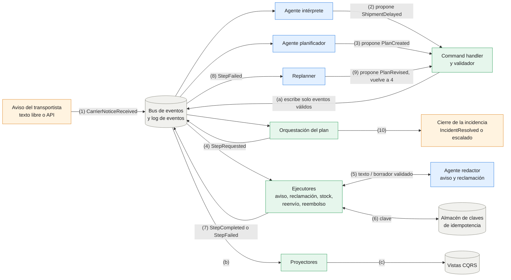
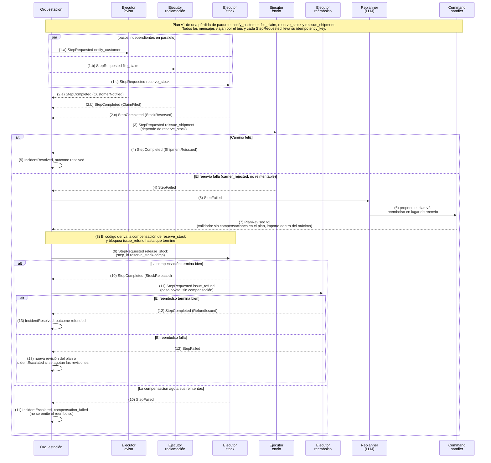
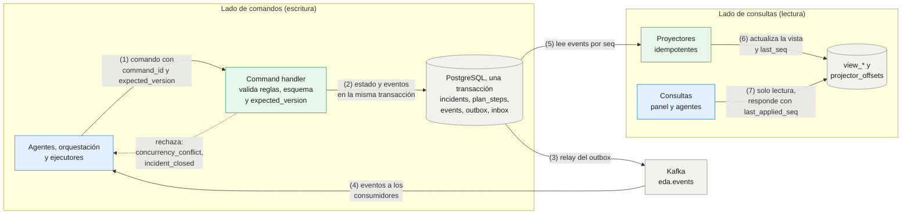

# PoC académica de EDA con agentes: incidencias logísticas

Specs en estilo OpenSpec. Cada capacidad vive en `specs/<capacidad>/spec.md` con un `## Purpose`, los requisitos (`### Requirement:`, redactados con SHALL/MUST) y al menos un escenario GIVEN/WHEN/THEN (`#### Scenario:`) por requisito.

## Contexto

Una tienda online recibe avisos de retraso de los transportistas, en texto libre o por API. Ante cada incidencia, un sistema de agentes decide qué hacer (avisar al cliente, reclamar al transportista, reenviar, reponer o reembolsar) y lo ejecuta mediante eventos. La PoC compara esta arquitectura con una base síncrona y mide fiabilidad, recuperación, calidad del plan, coste y latencia.

Regla de diseño: **el LLM propone y el código dispone**. Ningún LLM ejecuta efectos ni escribe directamente en el log.

## Diagrama de agentes

Azul: agentes con LLM (proponen). Verde: código determinista (dispone). Gris: datos. Naranja: entrada y salida. Los pasos (1) a (10) siguen el flujo de una incidencia, con el bus entre cada productor y su consumidor; (a) a (c) son la escritura validada y la proyección de las vistas. Los agentes con LLM nunca escriben en el log ni ejecutan efectos.

### Secuencia de la saga

Operaciones y compensaciones de una pérdida de paquete, con los caminos de éxito, de reembolso tras compensar y de escalado.

### CQRS

Lado de comandos (escritura) y lado de consultas (lectura). Los pasos (1) a (4) son el camino de escritura y (5) a (7), el de lectura.

## Patrones de la guía que se ejercitan

| Patrón (guía «Patrones aplicados al desarrollo de agentes») | Capacidad |
| --- | --- |
| Planning orientado a eventos (9.2), Plan-and-Execute (3.3), Saga (6.3) | `incident-planning` |
| Control optimista de concurrencia (5.6) | `cqrs-views` |
| CQRS (9.4), Outbox (6.4) | `event-backbone`, `cqrs-views` |
| Idempotency key (6.2) | `idempotency` |
| Retry con backoff y dead letter (6.6), Backpressure (5.7), Durable execution (6.1) | `resilience` |
| Guardrails (3.9), Bounded autonomy (3.10) | `llm-boundaries` |
| Tracing distribuido (6.10) | `observability-audit` |
| Evals como quality gates (8.1) | `experiments` |

## Capacidades

| Capacidad | Resumen |
| --- | --- |
| `event-backbone` | Formato del evento, log de eventos, bus, orden y entrega |
| `incident-interpretation` | Agente intérprete: del aviso en texto libre a `ShipmentDelayed` |
| `incident-planning` | Planner, replanner, versionado del plan, dependencias, compensación |
| `step-execution` | Ejecutores de pasos y sus efectos |
| `idempotency` | Claves, almacén de claves y reglas por efecto |
| `cqrs-views` | Command handler, proyectores, vistas y reconstrucción |
| `resilience` | Reintentos, dead letter, recuperación y backpressure |
| `llm-boundaries` | Validación de las salidas del LLM y límites de autonomía |
| `observability-audit` | Trazas, coste por incidencia y auditoría |
| `synthetic-data` | Generador de avisos e inyección de fallos |
| `experiments` | Hipótesis, experimentos, métricas y base síncrona |

## Catálogo de eventos

| Evento | Productor | Campos propios del payload |
| --- | --- | --- |
| `CarrierNoticeReceived` | Entrada | `carrier_notice_id`, `carrier`, `raw_text` |
| `ShipmentDelayed` | Agente intérprete | `incident_id`, `order_ids`, `cause`, `estimated_delay_hours`, `severity` |
| `PlanCreated` | Agente planificador | `incident_id`, `plan_version`, `steps[]` |
| `PlanRevised` | Replanner | `incident_id`, `plan_version`, `steps[]`, `reason` |
| `StepRequested` | Orquestación del plan | `incident_id`, `plan_version`, `step_id`, `action`, `params`, `idempotency_key` |
| `StepCompleted` (v2) | Ejecutor | `step_id`, `plan_version`, `result` |
| `StepFailed` (v2) | Ejecutor | `step_id`, `plan_version`, `error`, `retryable`, `attempts` |
| `StepCancelled` | Orquestación | `incident_id`, `plan_version`, `step_id` |
| `CustomerNotified` | Ejecutor | `order_id`, `message_id` |
| `ClaimFiled` | Ejecutor | `order_id`, `claim_id` |
| `StockReserved` | Ejecutor | `order_id`, `warehouse`, `reservation_id` |
| `StockReleased` | Ejecutor | `reservation_id` |
| `ShipmentReissued` | Ejecutor | `order_id`, `new_shipment_id` |
| `RefundIssued` | Ejecutor | `order_id`, `amount`, `refund_id` |
| `IncidentResolved` | Orquestación | `incident_id`, `outcome` |
| `IncidentEscalated` | Orquestación | `incident_id`, `reason` |
| `LlmCallRecorded` | Agentes con LLM | `incident_id`, `agent`, `model`, `tokens_in`, `tokens_out`, `latency_ms`, `validation_passed`, `attempt` |

## Catálogo de comandos

| Comando | Lo envía | Efecto (eventos que puede producir) |
| --- | --- | --- |
| `RegisterCarrierNotice` | Entrada | `CarrierNoticeReceived` |
| `OpenIncident` | Intérprete | `ShipmentDelayed` |
| `CreatePlan` | Planificador | `PlanCreated` |
| `RevisePlan` | Replanner | `PlanRevised` |
| `ApplyRevision` | Orquestación, al recibir `PlanRevised` | `StepCancelled` de los pasos no mantenidos; deriva en código los pasos `-comp` |
| `AdvancePlan` | Orquestación | Los `StepRequested` de todos los pasos listos, o `IncidentResolved` si el plan terminó |
| `RequestStep` | Orquestación | `StepRequested` |
| `RecordStepResult` | Ejecutores | `StepCompleted` o `StepFailed` y el evento de efecto (con la `plan_version` del `StepRequested`; uno obsoleto queda en el log sin cambiar el plan) |
| `CloseIncident` | Orquestación | `IncidentResolved` |
| `EscalateIncident` | Cualquiera | `IncidentEscalated` (si la incidencia aún no existe, la crea escalada a partir de su aviso) |
| `RecordLlmCall` | Agentes con LLM | `LlmCallRecorded` (no usa `expected_version` y admite incidencias cerradas) |

Todos llevan `command_id` y `expected_version` (`RecordLlmCall` lo ignora: es un hecho de solo añadir). Los comandos solo existen dentro del command handler; lo que se publica y se guarda son los eventos.

## Procesos

Cada componente es un proceso independiente (con `docker compose up -d` levantado):

| Comando | Qué hace |
| --- | --- |
| `uv run eda-relay` | Publica en Kafka las filas pendientes del outbox, en orden de `seq` |
| `uv run eda-projector` | Mantiene las vistas `view_*` leyendo `events` por `seq` |
| `uv run eda-agent interpreter` | Interpreta `CarrierNoticeReceived` y abre la incidencia |
| `uv run eda-agent planner` | Propone el plan a partir de `ShipmentDelayed` |
| `uv run eda-agent replanner` | Revisa el plan ante un `StepFailed` no reintentable |

Los agentes llaman a un modelo local de Ollama (`OLLAMA_HOST`, por defecto `http://localhost:11434`; `LLM_MODEL`, por defecto `llama3.1`; `LLM_SEED`, por defecto 42; `LLM_TIMEOUT_SECONDS`, por defecto 120) con `temperature` 0 para que las ejecuciones sean repetibles. Los tests usan siempre el cliente simulado.

## Decisiones asumidas

Anotadas aquí porque no estaban cerradas en la conversación; se pueden cambiar sin tocar el resto.

- CQRS sin event sourcing puro: el estado de escritura (`incidents`, `plan_steps`) se guarda en tablas y el log registra los hechos. Ambos se escriben en la misma transacción, y las vistas se reconstruyen desde el log.
- Saga: solo `reserve_stock` tiene compensación (`release_stock`). `issue_refund` es el paso pivote y se ejecuta el último.
- Los umbrales numéricos de las hipótesis (capacidad `experiments`) son valores iniciales.
- Pila fijada: Python, Apache Kafka (Docker, KRaft, un broker) como bus y PostgreSQL (Docker, volumen persistente) como log de eventos, outbox, inbox y almacén de claves. Los detalles están en `../design.md`; el esquema SQL, en `../db/init/001_schema.sql`, y la infraestructura local, en `../docker-compose.yml`.
- Los requisitos siguen hablando de «el bus», «el log» y «el almacén de claves» como conceptos; `design.md` indica cómo los materializa la pila.
- El envío de correos, el transportista, el almacén y los pagos son simulados.
- La `idempotency_key` se calcula con la versión del plan **en la que se creó el paso**, no con la vigente, para que un paso mantenido en una revisión conserve su clave y no se duplique. Esto afina la fórmula `hash(incident_id, plan_version, step_id)` del documento de casos de negocio.
- `StepCompleted` y `StepFailed` v2 llevan la `plan_version` del `StepRequested` que los pidió, para reconocer los resultados obsoletos. Los v1 se leen como de la versión 1 del plan (y `StepFailed` con un intento).

## Experimentos

| Experimento | Hipótesis | Capacidades implicadas |
| --- | --- | --- |
| E1 Duplicados en el bus | H1 | `idempotency`, `event-backbone` |
| E2 Caída de un ejecutor | H2 | `resilience`, `step-execution` |
| E3 Fallo de un paso y replanificación | H3 | `incident-planning`, `step-execution` |
| E4 Reconstrucción de vistas | H4 | `cqrs-views` |
| E5 Calidad del plan | H5 | `incident-planning`, `llm-boundaries` |
| E6 Eventos frente a síncrono | H6 | todas |
| E7 Auditabilidad | H7 | `observability-audit` |
