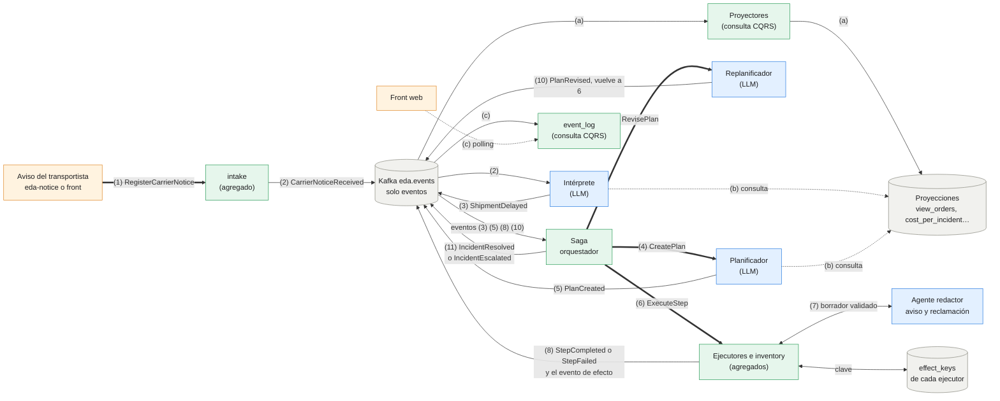
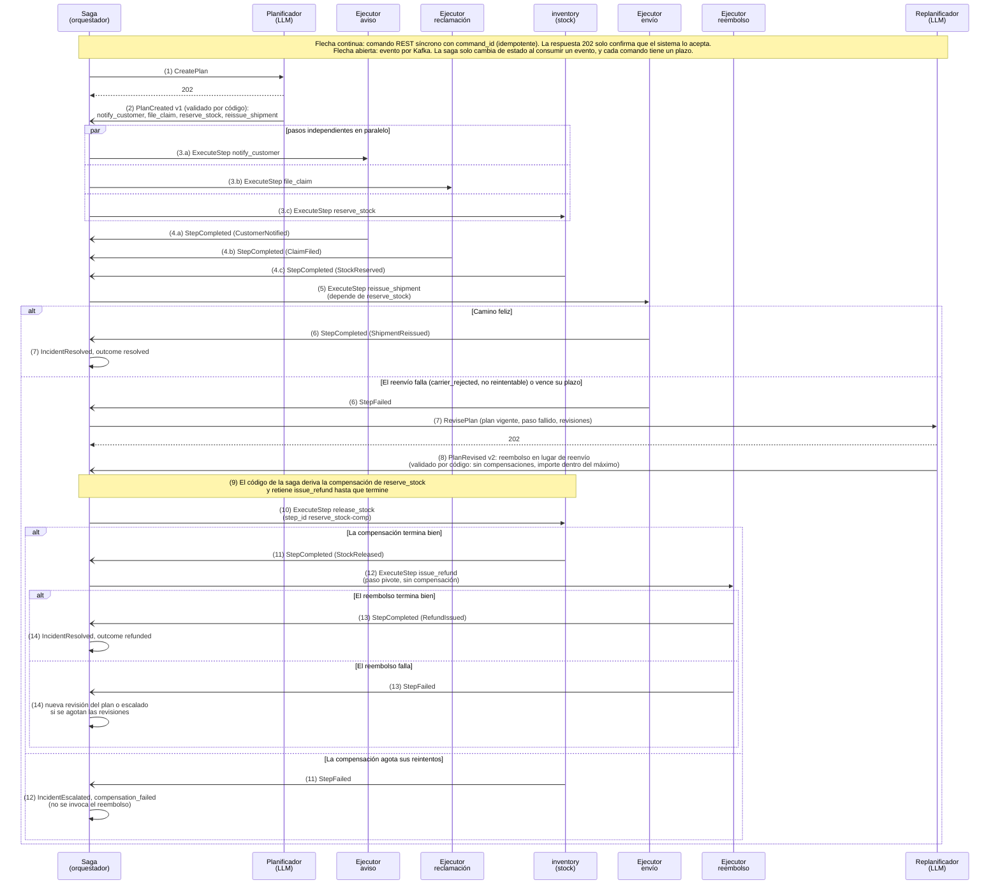
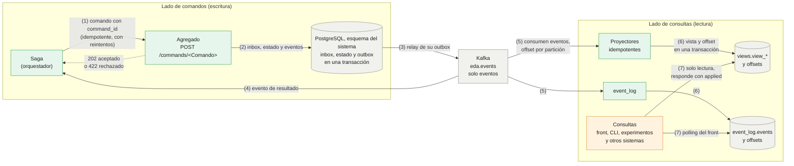
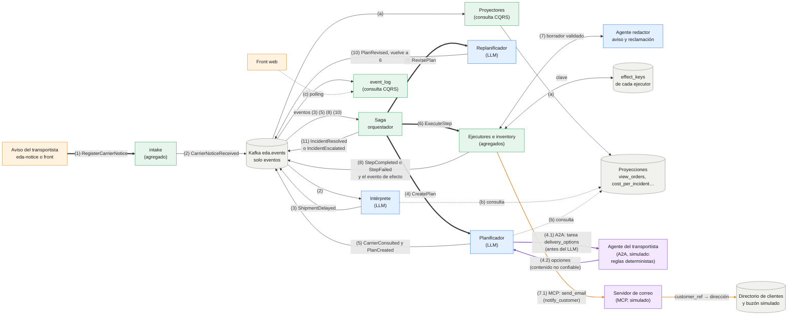
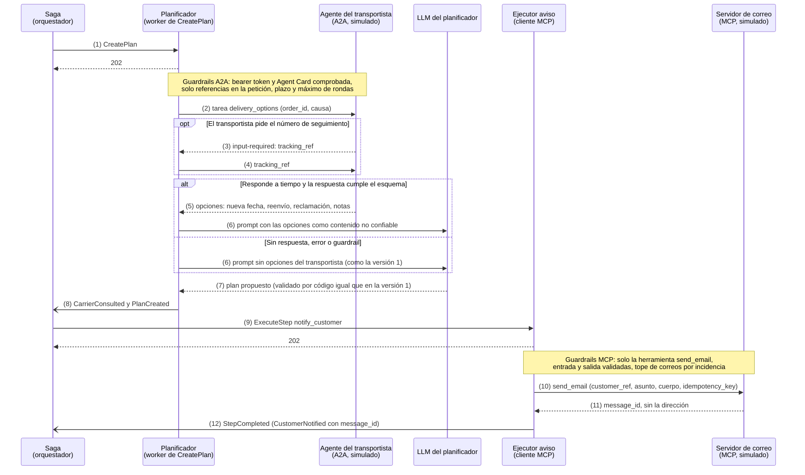

# PoC académica de EDA con agentes: incidencias logísticas

Specs en estilo OpenSpec. Cada capacidad vive en `specs/<capacidad>/spec.md` con un `## Purpose`, los requisitos (`### Requirement:`, redactados con SHALL/MUST) y al menos un escenario GIVEN/WHEN/THEN (`#### Scenario:`) por requisito.

## Contexto

Una tienda online recibe avisos de retraso de los transportistas, en texto libre o por API. Ante cada incidencia, un sistema de agentes decide qué hacer (avisar al cliente, reclamar al transportista, reenviar, reponer o reembolsar) y lo ejecuta mediante eventos. La PoC compara esta arquitectura con una base síncrona y mide fiabilidad, recuperación, calidad del plan, coste y latencia.

Regla de diseño: **el LLM propone y el código dispone**. Ningún LLM ejecuta efectos ni escribe directamente en el log.

## Diagrama de agentes



Azul: agentes con LLM (proponen). Verde: código determinista (dispone). Gris: datos. Naranja: entrada y front. Flecha gruesa: comando REST síncrono e idempotente (`command_id`), que el sistema que lo recibe acepta o rechaza. Flecha fina: evento por Kafka. Punteada: consulta de solo lectura a una proyección. Los pasos (1) a (11) siguen una incidencia: la saga invoca un comando, el sistema escribe su estado y su evento en su outbox en una transacción, y la saga reacciona al evento cuando le llega. (a) a (c) son el lado de lectura. Cada sistema solo escribe en su esquema; los agentes con LLM nunca escriben eventos ni ejecutan efectos.

### Secuencia de la saga



Operaciones y compensaciones de una pérdida de paquete, con los caminos de éxito, de reembolso tras compensar y de escalado. Si vence el plazo de un comando, la saga lo trata como un fallo no reintentable del paso (y pide su compensación si es compensable); si vence el de `CreatePlan`, `RevisePlan` o `issue_refund`, escala. Al escalar cancela los pasos pendientes y compensa las reservas cuyo dependiente no se completó.

### CQRS



Lado de comandos (escritura) y lado de consultas (lectura). Los pasos (1) a (4) son el camino de escritura: la saga invoca el comando, el sistema lo acepta o lo rechaza, y el resultado vuelve como evento. Los pasos (5) a (7) son el de lectura: los componentes de consulta consumen Kafka, y las personas y los sistemas consultan sus proyecciones, que van con retraso (consistencia eventual).

## Patrones de la guía que se ejercitan

| Patrón (guía «Patrones aplicados al desarrollo de agentes») | Capacidad |
| --- | --- |
| Planning orientado a eventos (9.2), Plan-and-Execute (3.3), Saga (6.3) | `incident-planning` |
| CQRS (9.4), Outbox e Inbox (6.4) | `event-backbone`, `cqrs-views`, `idempotency` |
| Idempotency key (6.2) | `idempotency` |
| Retry con backoff y dead letter (6.6), Backpressure (5.7), Durable execution (6.1) | `resilience` |
| Guardrails (3.9), Bounded autonomy (3.10) | `llm-boundaries` |
| Tracing distribuido (6.10) | `observability-audit` |
| Evals como quality gates (8.1) | `experiments` |

## Capacidades

| Capacidad | Resumen |
| --- | --- |
| `event-backbone` | Formato del evento, bus, orden y entrega, invocación de comandos y propiedad de los datos |
| `incident-interpretation` | Agente intérprete: del aviso en texto libre a `ShipmentDelayed` |
| `incident-planning` | Planner, replanner, versionado del plan, dependencias, compensación |
| `step-execution` | Ejecutores de pasos y sus efectos |
| `idempotency` | Claves, almacén de claves y reglas por efecto |
| `cqrs-views` | Command handlers de cada sistema, proyecciones, consultas, consistencia eventual y reconstrucción |
| `resilience` | Reintentos, dead letter, recuperación y backpressure |
| `llm-boundaries` | Validación de las salidas del LLM y límites de autonomía |
| `observability-audit` | Trazas, coste por incidencia y auditoría |
| `synthetic-data` | Generador de avisos e inyección de fallos |
| `experiments` | Hipótesis, experimentos, métricas y base síncrona |

## Catálogo de eventos

| Evento | Productor | Campos propios del payload |
| --- | --- | --- |
| `CarrierNoticeReceived` | Entrada | `carrier_notice_id`, `carrier`, `raw_text` |
| `ShipmentDelayed` | Agente intérprete | `incident_id`, `order_ids`, `cause`, `estimated_delay_hours`, `severity` |
| `PlanCreated` | Agente planificador | `incident_id`, `plan_version`, `steps[]` |
| `PlanRevised` | Replanner | `incident_id`, `plan_version`, `steps[]`, `reason` |
| `OrderRegistered` | `inventory` | `order_id`, `customer_ref`, `amount` |
| `NoticeParked` | Agente intérprete | `incident_id`, `order_ids` (los pedidos que espera), `deadline_at` (cuándo vence su plazo, ISO 8601) |
| `StepCompleted` (v2) | Ejecutor o `inventory` | `step_id`, `plan_version`, `result` |
| `StepFailed` (v2) | Ejecutor o `inventory` | `step_id`, `plan_version`, `error`, `retryable`, `attempts` |
| `StepCancelled` | Saga (orquestador) | `incident_id`, `plan_version`, `step_id` |
| `CustomerNotified` | Ejecutor | `order_id`, `message_id` |
| `ClaimFiled` | Ejecutor | `order_id`, `claim_id` |
| `StockReserved` | `inventory` | `order_id`, `warehouse`, `reservation_id` |
| `StockReleased` | `inventory` | `reservation_id` |
| `ShipmentReissued` | Ejecutor | `order_id`, `new_shipment_id` |
| `RefundIssued` | Ejecutor | `order_id`, `amount`, `refund_id` |
| `IncidentResolved` | Saga (orquestador) | `incident_id`, `outcome` |
| `IncidentEscalated` | Saga y agentes | `incident_id`, `reason` |
| `LlmCallRecorded` | Agentes con LLM | `incident_id`, `agent`, `model`, `tokens_in`, `tokens_out`, `latency_ms`, `validation_passed`, `attempt` |
| `CarrierConsulted` | Agente planificador (solo con `POC_VERSION=2`) | `incident_id`, `outcome` (`answered`, `timeout`, `failed` o `rejected_by_guardrail`), `rounds`, `latency_ms`; sin `notes` ni datos personales (spec `a2a-carrier`) |

## Catálogo de comandos

| Comando | Lo invoca | Lo atiende | Eventos que puede producir |
| --- | --- | --- | --- |
| `RegisterCarrierNotice` | `eda-notice`, front | `intake` | `CarrierNoticeReceived` |
| `SeedSampleData` | `eda-notice` | `inventory` | `OrderRegistered` |
| `OpenIncident` | El propio intérprete, al consumir `CarrierNoticeReceived` | `interpreter` | `ShipmentDelayed`, `NoticeParked` o `IncidentEscalated` |
| `CreatePlan` | La saga (orquestador), al consumir `ShipmentDelayed` | `planner` | `PlanCreated` o `IncidentEscalated`; con `POC_VERSION=2`, antes `CarrierConsulted` |
| `RevisePlan` | La saga, al consumir un `StepFailed` no reintentable o vencer el plazo de un paso | `replanner` | `PlanRevised` o `IncidentEscalated` |
| `ExecuteStep` (`incident_id`, `plan_version`, `step_id`, `action`, `params`, `idempotency_key`) | La saga | `executor-<acción>`, o `inventory` para `reserve_stock` y `release_stock` | `StepCompleted` o `StepFailed` y el evento de efecto |
| `RecordLlmCall` | Cada componente con LLM, dentro de su propio handler | El mismo componente | `LlmCallRecorded` |

El orquestador no recibe comandos: es el process manager de la saga, consume eventos e invoca `CreatePlan`, `RevisePlan` y `ExecuteStep`. Cada sistema expone sus comandos por REST (`POST /commands/<Comando>`) y la saga los invoca de forma síncrona desde su `command_outbox`; los comandos nunca viajan por Kafka y su resultado llega como evento. Todo comando es idempotente: el handler lo deduplica con su inbox por `command_id`. Todos llevan `command_id` y como `causation_id` el evento que los originó; los de la saga llevan la `plan_version` vigente, y un plazo guardado en `orchestrator.deadlines`.

## Procesos

> Cada componente tiene su esquema de PostgreSQL, su API de comandos (si atiende comandos), su outbox con su propio relay y su proceso (`odd/tasks/eda-component-ownership.md`). El esquema público ya no tiene tablas del sistema (migración 0017).

### Puesta en marcha

Con Docker y Ollama instalados, y `.env` creado a partir de `.env.example` (fija `LLM_MODEL` a un modelo descargado, p. ej. `qwen2.5:7b-instruct`):

```bash
scripts/start-all.sh           # terminal 1: contenedores, migraciones, todos los procesos y el front web
                               #   (--version 2 para la segunda versión, con MCP y A2A)
scripts/notice.sh              # terminal 2: CLI interactivo de avisos (o el menú del front)
tail -f logs/*.log             # terminal 3: seguir el flujo
scripts/stop-all.sh            # al terminar: para los procesos, el front y los contenedores
```

`scripts/start-all.sh` equivale a `docker compose up -d` más `scripts/run-agents.sh` y `scripts/run-web.sh`, que también se pueden lanzar por separado. El front queda en `http://localhost:5173`.

La versión de la PoC se elige al arrancar con `--version 1|2` (en `start-all.sh`, `run-agents.sh` y `run-web.sh`): la opción gana a `POC_VERSION` de `.env`, y sin ella se usa la de `.env` o, si no está, la 1. `start-all.sh` pasa la versión a `run-agents.sh` y a `run-web.sh`, así que los procesos y el backend del front corren la misma; si se lanzan por separado, hay que darles la misma versión. La cabecera del front muestra la versión activa: «Versión 1» o «Versión 2 (MCP + A2A)».

En el CLI interactivo, `s` carga los datos de ejemplo (pedidos `P-1001`…`P-1005` y su stock) y `1`…`4` envían un aviso de ejemplo; después se muestra cómo avanza la incidencia hasta que se resuelve o se escala. Las trazas completas están en Jaeger: `http://localhost:16686`.

El front web (`scripts/run-web.sh`, spec `web-front`) hace lo mismo desde el navegador: el menú de la izquierda lanza los comandos de `scripts/notice.sh`, el mapa muestra los agentes, servicios e integraciones con su estado y resalta el camino de cada evento nuevo, y el panel inferior sigue los eventos en vivo (emisor, destino, partición/offset de Kafka y enlace a su traza en Jaeger). Al pulsar un nodo se ven su detalle y, en los agentes, sus métricas del LLM. El enlace «Analítica» de la cabecera abre la vista de negocio: cuántos pedidos afectados por incidencias hay en cada estado (envío retrasado, en proceso de solución, solucionada, reembolsada, escalada) y la tabla de pedidos, en vivo. Mientras el intérprete tenga avisos aparcados esperando pedidos que aún no existen (p. ej. un aviso enviado sin haber lanzado `seed`), las dos vistas muestran bajo la cabecera un aviso con sus pedidos y la hora a la que vence cada uno (`GET /api/parked-notices`, vista `parked_notices`). Solo escucha en localhost y lee la base de datos con una conexión de solo lectura. El front no ofrece `interactive` (`WEB_INTERACTIVE=true` en `.env` lo vuelve a ofrecer) ni texto libre, ni `send --text` ni la opción `t` de `interactive`, que se lanza con `--no-free-text` (`WEB_FREE_TEXT=true` lo vuelve a ofrecer).

### Scripts

| Script | Qué hace |
| --- | --- |
| `scripts/start-all.sh [--version 1\|2] [--logs DIR] [--no-web]` | Arranca todo: `docker compose up -d`, espera a que postgres y kafka estén healthy, aplica las migraciones y lanza `run-agents.sh` y `run-web.sh` (sin el front con `--no-web`), los dos con la versión de `--version` (por defecto, `POC_VERSION` de `.env` o 1; otro valor termina con error y el uso). Ctrl+C para los procesos y el front y deja los contenedores; si uno de los dos scripts termina, para el otro |
| `scripts/run-agents.sh [--version 1\|2] [--logs DIR] [--no-migrate]` | Comprueba que kafka y postgres están en marcha y que Ollama tiene `LLM_MODEL`, aplica las migraciones y arranca todos los procesos cargando `.env`; deja un log por proceso en `logs/` y los para todos con Ctrl+C o si alguno termina. `--version` gana a `POC_VERSION` de `.env`; una versión no válida termina con error sin arrancar nada. Solo con la versión 2 arranca además los procesos de la segunda versión: `eda-mail-server` (servidor de correo MCP) y `eda-carrier-agent` (agente A2A del transportista) |
| `scripts/notice.sh [argumentos de eda-notice]` | Abre `eda-notice` (por defecto, el modo interactivo) con la misma configuración (`.env`) |
| `scripts/run-web.sh [--version 1\|2] [--logs DIR]` | Arranca el front web: `eda-web` en `127.0.0.1:WEB_PORT` (8000 por defecto) y Vite en `http://localhost:5173`; la primera vez instala las dependencias de `web/` (`npm ci`, requiere Node 24). Carga `.env` (`WEB_PORT`, `JAEGER_UI_URL`) y para los dos con Ctrl+C o si uno termina. `--version` (gana a `POC_VERSION` de `.env`) elige el mapa, los procesos vigilados y la insignia de la cabecera |
| `scripts/stop-all.sh [--dry-run] [--keep-docker]` | Para todos los procesos de la PoC (también el front, su backend, Vite y los de la versión 2, `eda-mail-server` y `eda-carrier-agent`) y después los contenedores (`docker compose stop`, sin borrar datos); `--keep-docker` deja los contenedores y `--dry-run` solo muestra qué pararía |

### Comandos

Cada componente es un proceso independiente; los scripts anteriores los lanzan, pero también se pueden arrancar uno a uno. Todos los comandos `eda-*` cargan solos el `.env` del directorio de trabajo, sin pisar las variables ya definidas (no hace falta `--env-file`):

| Comando | Qué hace |
| --- | --- |
| `uv run eda-event-log` | Consulta de CQRS `event_log`: consume `eda.events` y guarda cada evento en `event_log.events` con un `seq` creciente, su partición, su offset y su contexto de traza; su posición va en `event_log.offsets`. El front lee el log de ahí |
| `uv run eda-intake` | Sistema `intake`: atiende `RegisterCarrierNotice` en `POST /commands/RegisterCarrierNotice` (escucha en `INTAKE_URL`, por defecto `http://127.0.0.1:8101`), guarda el aviso en `intake.carrier_notices` y publica `CarrierNoticeReceived` con el relay de `intake.outbox`. `eda-notice` y el front registran los avisos aquí |
| `uv run eda-inventory` | Sistema `inventory`: atiende `SeedSampleData` y `ExecuteStep` de `reserve_stock` y `release_stock` (escucha en `INVENTORY_URL`, por defecto `http://127.0.0.1:8102`) sobre `inventory.orders`, `stock` y `reservations`, y publica `OrderRegistered`, `StockReserved`, `StockReleased`, `StepCompleted` y `StepFailed` con el relay de `inventory.outbox`. Lo invoca la saga |
| `uv run eda-projector` | Mantiene las vistas `views.view_*` (`orders`, `incident_status`, `cost_per_incident`, `audit_trail`, `carrier_dashboard`, `order_status`, `parked_notices`) consumiendo `eda.events` de Kafka, cada proyector con su offset por partición en `views.offsets` |
| `uv run eda-projector rebuild <vista>` | Vacía una vista y su posición, vuelve a consumir `eda.events` desde el principio e imprime la huella antes y después, si son idénticas y el tiempo de reconstrucción (sale con código 1 si difieren). Se lanza con `eda-projector` parado |
| `uv run eda-interpreter` | Sistema `interpreter` (LLM + su command handler): consume `CarrierNoticeReceived` y publica `ShipmentDelayed` o `IncidentEscalated` y un `LlmCallRecorded` por llamada desde `interpreter.outbox`. Consulta el presupuesto en `view_cost_per_incident` y los pedidos en `view_orders`; si la vista aún no tiene ninguno, aparca el aviso en `interpreter.pending_notices` y publica `NoticeParked` en la misma transacción, hasta su `OrderRegistered` o hasta `PENDING_NOTICE_TIMEOUT_S` (300 s por defecto). |
| `uv run eda-planner` | Sistema `planner` (LLM + su command handler): atiende `CreatePlan` en `POST /commands/CreatePlan` (escucha en `PLANNER_URL`, por defecto `http://127.0.0.1:8103`) con la incidencia (pedidos, causa, retraso y gravedad). Consulta el presupuesto en `view_cost_per_incident` y los importes en `view_orders`, valida el plan en código (acciones, compensaciones, dependencias, tope de reembolso e importe del pedido) y publica `PlanCreated` o `IncidentEscalated` y un `LlmCallRecorded` por llamada desde `planner.outbox`; una incidencia con plan rechaza otro `CreatePlan` con `plan_exists`. Lo invoca la saga. Con `POC_VERSION=2` y gravedad `medium` o `high`, antes del LLM consulta al agente del transportista por A2A y publica `CarrierConsulted`; la gravedad `low` usa el plan fijo y no consulta. |
| `uv run eda-carrier-agent` | Solo con `POC_VERSION=2`. Agente del transportista simulado (A2A, spec `a2a-carrier`): publica su Agent Card en `/.well-known/agent-card.json` y atiende la skill `delivery_options` por JSON-RPC sobre HTTP en `127.0.0.1:CARRIER_AGENT_PORT`, con bearer token (`A2A_CARRIER_TOKEN`). Decide con reglas deterministas por causa y semilla (`CARRIER_AGENT_SEED`; tabla en `src/eda_retail/carrier_agent/rules.py`) y pide `tracking_ref` (`input-required`) en `loss` y `damage`. Sin base de datos ni datos personales |
| `uv run eda-replanner` | Sistema `replanner` (LLM + su command handler): atiende `RevisePlan` en `POST /commands/RevisePlan` (escucha en `REPLANNER_URL`, por defecto `http://127.0.0.1:8104`) con el plan vigente (cada paso con su estado), el paso fallido, su error y las revisiones hechas; no lee el estado del orquestador. Consulta el presupuesto en `view_cost_per_incident` y los importes en `view_orders`, valida la revisión en código (las reglas del plan, pasos completados, acción de los pasos mantenidos y estabilidad de los `step_id`) y publica `PlanRevised` o `IncidentEscalated` (`max_revisions` sin LLM cuando no quedan revisiones) y un `LlmCallRecorded` por llamada desde `replanner.outbox`; una versión ya revisada rechaza otro `RevisePlan` con `revision_exists`. |
| `uv run eda-orchestrator` | Sistema `orchestrator`, la saga reactiva (sin command handler): consume `ShipmentDelayed`, `PlanCreated`, `PlanRevised`, `StepCompleted`, `StepFailed` e `IncidentEscalated`, guarda su estado en `orchestrator.incidents` y `plan_steps`, e invoca por REST desde su `command_outbox` `CreatePlan` (`PLANNER_URL`), `RevisePlan` (`REPLANNER_URL`, por defecto `http://127.0.0.1:8104`) y `ExecuteStep` (`INVENTORY_URL` para `reserve_stock` y `release_stock`; `EXECUTOR_<ACCIÓN>_URL`, por defecto `8111`–`8114`, para el resto), reintentando con el mismo `command_id` si el sistema no responde. Cada comando lleva un plazo (`SAGA_PLAN_TIMEOUT_S`, 300 s; `SAGA_STEP_TIMEOUT_S`, 60 s). Publica `StepRequested` (notificación para la auditoría y el front), `StepCancelled`, `IncidentResolved` e `IncidentEscalated` desde `orchestrator.outbox`. Los ejecutores de `notify_customer`, `file_claim`, `reissue_shipment` e `issue_refund` son `eda-step-executor <acción>` |
| `uv run eda-notice [interactive --timeout N --no-free-text]` | Modo interactivo: menú para enviar avisos (de ejemplo o texto libre) y seguir cada incidencia en la vista `incident_status` hasta que se cierra; `--no-free-text` quita el texto libre del menú |
| `uv run eda-notice seed` | Envía `SeedSampleData` a `inventory` (`INVENTORY_URL`) con los pedidos (`P-1001`…`P-1005`) y el stock de ejemplo; repetirlo no duplica nada |
| `uv run eda-notice send [--example delay\|loss\|out_of_stock\|injection] [--text "…"]` | Envía `RegisterCarrierNotice` a `intake` (`INTAKE_URL`): la entrada que pone en marcha el flujo. Si `intake` o `inventory` no responden en `COMMAND_HTTP_TIMEOUT_S`, termina con error |
| `uv run eda-web [--port N]` | Backend del front web (API y streams SSE) en `127.0.0.1`, puerto `WEB_PORT` (8000 por defecto); nunca escucha en otra interfaz |
| `uv run eda-mail-server [--no-seed]` | Segunda versión (`POC_VERSION=2`, spec `mcp-mail`): servidor de correo simulado con MCP por Streamable HTTP en `127.0.0.1:MAIL_SERVER_PORT` (8120 por defecto), ruta `/mcp`. Expone una sola herramienta, `send_email(customer_ref, subject, body, idempotency_key)`, que devuelve `message_id` y `accepted_at`: resuelve la dirección en su directorio (`mail_server.customers`), guarda el correo en su buzón simulado (`mail_server.mailbox`, un correo por clave) y responde `unknown_customer` si el cliente no está. Al arrancar siembra el directorio con una dirección sintética `<customer_ref>@example.test` para cada cliente del generador y de los datos de ejemplo (`--no-seed` lo omite). La dirección no sale nunca del servidor |
| `uv run eda-step-executor <acción>` | Ejecutor de `notify_customer`, `file_claim`, `reissue_shipment` o `issue_refund`, un proceso por acción: atiende el `ExecuteStep` de la saga en `POST /commands/ExecuteStep` (escucha en `EXECUTOR_<ACCIÓN>_URL`, por defecto `8111`–`8114`). Comprueba el pedido en `view_orders`, redacta el aviso o la reclamación con el redactor (la causa y el retraso llegan en el comando; presupuesto de `view_cost_per_incident`), llama al servicio simulado con la `idempotency_key` reintentando los errores transitorios (`STEP_MAX_ATTEMPTS`) y, en una transacción, registra la clave en `executor_<acción>.effect_keys`, el efecto en su tabla y publica el evento del efecto y `StepCompleted`, o `StepFailed` (con `IncidentEscalated` `refund_limit` antes si el reembolso supera el máximo). Una clave ya completada devuelve el resultado guardado sin repetir el efecto. Con `POC_VERSION=2`, el de `notify_customer` envía el correo como cliente MCP de `eda-mail-server` (`MAIL_SERVER_URL`) en lugar del servicio simulado en proceso |

Cada proceso escribe en stdout una línea por evento recibido, por comando (aceptado o rechazado, con los eventos que produce) y por reintento (`LOG_LEVEL`, por defecto `INFO`); el detalle completo está en las trazas de Jaeger (`http://localhost:16686`).

Los ejecutores reintentan los errores transitorios hasta `STEP_MAX_ATTEMPTS` (por defecto 3) con espera exponencial y jitter (`STEP_BACKOFF_BASE_SECONDS`, por defecto 0,5; `STEP_BACKOFF_MAX_SECONDS`, por defecto 10) y atienden como mucho `EXECUTOR_MAX_CONCURRENCY` comandos `ExecuteStep` a la vez (por defecto 5; también `eda-inventory`): por encima responden 503 y la saga reintenta el comando con el mismo `command_id`. Un evento con esquema inválido o que agota sus reintentos va a la tabla `dead_letters`, y el relay lo publica en `eda.dlq` (`DLQ_TOPIC`).

La versión de la PoC se elige con `POC_VERSION` (en `.env` o en el entorno): `1` por defecto, o `2`; cualquier otro valor detiene el proceso con un error. Con `1` el sistema se comporta exactamente como la primera versión. Con `2` se activa la segunda versión: el ejecutor de `notify_customer` envía el correo por el servidor de correo MCP y el planificador consulta al agente del transportista por A2A. Las variables propias de MCP son `MAIL_SERVER_URL` (URL del servidor para el cliente, por defecto `http://127.0.0.1:8120/mcp`), `MAIL_SERVER_PORT` (puerto en el que escucha `eda-mail-server`, por defecto 8120) y `MCP_MAX_EMAILS_PER_INCIDENT` (correos como mucho por incidencia, por defecto 3; superarlo termina el paso en `StepFailed` `mail_limit_exceeded`). El front muestra el servidor de correo y el agente del transportista como procesos vigilados solo con la versión 2.

Con `POC_VERSION=2`, el planificador consulta al agente del transportista en `CARRIER_AGENT_URL` (por defecto `http://127.0.0.1:8130`, la URL que publica su Agent Card) con el bearer token `A2A_CARRIER_TOKEN` (obligatorio; el agente no arranca sin él), un plazo total de `A2A_TIMEOUT_S` (por defecto 5 s) y como mucho `A2A_MAX_ROUNDS` rondas `input-required` (por defecto 2). El agente escucha en `127.0.0.1:CARRIER_AGENT_PORT` (por defecto 8130) y sus reglas usan la semilla `CARRIER_AGENT_SEED` (por defecto 42). Los experimentos (`eda-experiment`) no consultan al agente aunque `POC_VERSION=2`, para que E5 y E6 sigan siendo comparables con la primera versión.

Los agentes llaman a un modelo local de Ollama (`OLLAMA_HOST`, por defecto `http://localhost:11434`; `LLM_MODEL`, por defecto `llama3.1`; `LLM_SEED`, por defecto 42; `LLM_TIMEOUT_SECONDS`, por defecto 120) con `temperature` 0 para que las ejecuciones sean repetibles. Los tests usan siempre el cliente simulado.

La vista `cost_per_incident` guarda solo hechos del log (tokens, reclamaciones, reenvíos e importe reembolsado); la consulta calcula el coste en dinero con `LLM_PRICE_IN_PER_1K` y `LLM_PRICE_OUT_PER_1K` (precio por cada 1000 tokens de entrada y de salida) y `EFFECT_COST_CLAIM` y `EFFECT_COST_REISSUE` (coste de cada reclamación y de cada reenvío); un reembolso cuesta su importe. Todos valen 0 por defecto, porque Ollama es local. Así una vista reconstruida es idéntica aunque cambien los precios.

Las consultas (`queries/`) solo leen las tablas `views.view_*` y las posiciones de los proyectores en `views.offsets`, nunca escriben y devuelven `applied` (el offset aplicado por partición): `get_incident_status`, `get_incident_cost`, `get_audit_trail`, `get_carrier_dashboard`, `get_order_status` y `get_parked_notices` (los avisos aparcados por el intérprete, por plazo; el front los muestra con `GET /api/parked-notices`).

## Decisiones asumidas

Anotadas aquí porque no estaban cerradas en la conversación; se pueden cambiar sin tocar el resto.

- CQRS sin event sourcing puro: cada sistema guarda su estado de escritura en sus tablas y publica sus eventos desde su outbox en la misma transacción. Las proyecciones (y la vista del log de `event_log`) se construyen consumiendo Kafka y se reconstruyen volviendo a consumir el topic.
- Saga: solo `reserve_stock` tiene compensación (`release_stock`). `issue_refund` es el paso pivote y se ejecuta el último.
- Los umbrales numéricos de las hipótesis (capacidad `experiments`) son valores iniciales.
- Pila fijada: Python, Apache Kafka (Docker, KRaft, un broker) como bus de eventos y PostgreSQL (Docker, volumen persistente) como almacén de cada componente, con un esquema por componente y sin relaciones entre ellos: estado, outbox, inbox, claves de idempotencia y proyecciones. Los detalles están en `../design.md`; el esquema SQL, en `../db/init/001_schema.sql`, y la infraestructura local, en `../docker-compose.yml`.
- Los requisitos hablan de «el bus», «el log» y «el almacén de claves» como conceptos; `design.md` indica cómo los materializa la pila.
- El envío de correos, el transportista, el almacén y los pagos son simulados.
- La `idempotency_key` se calcula con la versión del plan **en la que se creó el paso**, no con la vigente, para que un paso mantenido en una revisión conserve su clave y no se duplique. Esto afina la fórmula `hash(incident_id, plan_version, step_id)` del documento de casos de negocio.
- La saga es un process manager reactivo en el orquestador: decide al consumir cada evento con el estado de `orchestrator.plan_steps`, invoca comandos por REST y no atiende ninguno. Varias compensaciones se encadenan en orden inverso al de los pasos originales.
- Un paso que el plan revisado no mantiene y que no llegó a tener efecto (`pending`, `requested` o `failed`) pasa a `cancelled`. Un resultado de una versión anterior del plan queda en el log, pero no se usa para decidir.
- `StepCompleted` y `StepFailed` v2 llevan la `plan_version` del comando `ExecuteStep` que los pidió, para reconocer los resultados obsoletos. Los v1 se leen como de la versión 1 del plan (y `StepFailed` con un intento).

## Experimentos

| Experimento | Hipótesis | Capacidades implicadas |
| --- | --- | --- |
| E1 Duplicados en el bus | H1 | `idempotency`, `event-backbone` |
| E2 Caída de un ejecutor | H2 | `resilience`, `step-execution` |
| E3 Fallo de un paso y replanificación | H3 | `incident-planning`, `step-execution` |
| E4 Reconstrucción de vistas | H4 | `cqrs-views` |
| E5 Calidad del plan | H5 | `incident-planning`, `llm-boundaries` |
| E6 Eventos frente a síncrono | H6 | todas |
| E7 Auditabilidad | H7 | `observability-audit` |

### Cómo se ejecutan

Cada experimento se lanza con un solo comando y escribe su informe en `experiments/results/<exp>-<fecha>/` (`report.json` y `report.md`, con la semilla, la configuración, el modelo, la versión de los prompts y las métricas). Necesita `docker compose` en marcha; no hace falta arrancar los procesos:

```bash
uv run eda-experiment e1 --seed 42 --incidents 50
```

El arnés (`experiments/harness.py`) monta el sistema completo en un solo proceso, con los componentes de `scripts/run-agents.sh` (los command handlers se ejecutan en el proceso, sin HTTP; el intérprete y la saga consumen Kafka; cada componente publica su outbox; `event_log` y los proyectores mantienen el lado de lectura), contra una base de datos y un topic propios de cada ejecución que se borran al terminar. Los avisos salen del generador con semilla (`synthetic/generator.py`) y los fallos se inyectan con `synthetic/faults.py`. E1–E4 y E7 usan un LLM oráculo que responde con las etiquetas del generador, así miden la arquitectura y no el modelo; E5 y E6 usan Ollama.

E1 compara tres modos de idempotencia: `full` (todo activo), `no_effect_keys` (los ejecutores sin inbox, sin `effect_keys` y con servicios que no reconocen la clave) y `none` (todo desactivado). H1 se evalúa con los dos primeros; `none` se informa como observación: sin inbox, un evento repetido vuelve a llegar al planificador y la incidencia se escala antes de ejecutar ningún paso. Sin la idempotencia de los efectos, la segunda ejecución de un paso choca con la restricción UNIQUE de su tabla, el ejecutor cae y Kafka vuelve a entregar el mensaje: el efecto externo se repite hasta que el arnés salta el mensaje tras tres caídas.

| Comando | Qué hace |
| --- | --- |
| `uv run eda-experiment e1` | E1: cada evento y cada comando de la saga entregados 2 y 3 veces, en los tres modos de idempotencia |
| `uv run eda-experiment e2` | E2: el ejecutor de `notify_customer` cae tras la mitad de sus pasos, después de confirmar y antes de responder; la saga lo reinvoca con el mismo `command_id` |
| `uv run eda-experiment e3` | E3: 30 incidencias de pérdida con los dos almacenes sin stock; el replanner sustituye la reserva y el reenvío por un reembolso |
| `uv run eda-experiment e4` | E4: 200 incidencias; borra cada vista, la reconstruye volviendo a consumir el topic de la ejecución y compara las huellas |
| `uv run eda-experiment e5` | E5: el planificador aislado, con la interpretación etiquetada, sobre 40 incidencias y 3 repeticiones con Ollama; acierto global, por causa y planes que no coinciden. `--llm oracle` lo ejecuta sin coste y `--threshold` cambia el umbral de H5 (0,8) |
| `uv run eda-experiment e6` | E6: las dos versiones con los mismos avisos y el mismo LLM, sin fallos y con fallos (cada evento 2 veces y un 30 % de fallos en `reserve_stock`), 50 incidencias y 3 repeticiones con Ollama; latencia (media, mediana y p95), tokens, coste, incidencias resueltas y efectos duplicados. `--llm oracle` lo ejecuta sin coste |
| `uv run eda-experiment e7` | E7: 50 incidencias con un 50 % de fallos en `reserve_stock`; explica 10 elegidas al azar con `audit_trail` y la cadena de `causation_id` |

Sin `--incidents`, cada experimento usa el tamaño de su escenario en la spec (E1 y E2: 50; E3: 30; E4: 200; E7: 50).

La base síncrona de referencia (`baseline_sync/runner.py`) atiende cada aviso de principio a fin en una sola llamada, con los mismos prompts y comprobaciones de los agentes, las mismas reglas del plan, las mismas acciones de los ejecutores y las mismas compensaciones, pero sin `events`, outbox, inbox, vistas ni Kafka. Guarda el estado de negocio en su esquema `baseline_sync` (migración 0016) de una base de datos PostgreSQL propia de cada ejecución, así E6 compara las dos versiones con la misma base de datos. Recibe los mismos avisos y los mismos fallos de negocio que la versión de eventos; un aviso repetido devuelve la incidencia ya creada.

E5 y E6 repiten 3 veces con Ollama. Cada repetición usa su propia semilla (`--seed` + número de repetición) y temperatura 0,7 (`--temperature`): con temperatura 0 y la misma semilla las repeticiones salen idénticas y no muestran ninguna variación. El sistema sigue con temperatura 0 por defecto (`LLM_TEMPERATURE`).

La latencia de E6 se lee con cuidado: el arnés atiende los consumidores por turnos en un solo proceso, con esperas cortas en cada consumidor, así que la latencia de la versión de eventos incluye ese reparto de turnos y no es la de un despliegue con un proceso por componente. Con el oráculo la diferencia la marca el arnés; con Ollama la domina el LLM.

E6 escala los plazos de la saga (`SAGA_PLAN_TIMEOUT_S`, `SAGA_STEP_TIMEOUT_S`) con el número de incidencias, 30 s por incidencia y nunca por debajo de los valores por defecto, porque la base síncrona no tiene plazos y el LLM es una sola cola compartida: un plazo empieza en el primer envío e incluye la espera del trabajo en esa cola. El informe guarda los plazos usados en `config.saga_deadlines`. Fuera de E6 los plazos no cambian.

## Segunda versión

La segunda versión de la PoC añade los dos modos de comunicación que faltan, MCP y A2A, para cubrir todos los de un sistema distribuido con agentes y mostrar cuándo conviene cada uno. Sus requisitos están en `specs/mcp-mail/spec.md` y `specs/a2a-carrier/spec.md`. Están construidos los dos: el servidor de correo MCP y el agente del transportista (A2A).

Se activa con `scripts/start-all.sh --version 2` o con `POC_VERSION=2` en `.env` (la opción gana a `.env`); sin ninguna de las dos, o con la versión 1, la PoC es la primera versión. Cómo activarla, en «Versión 2».

| Modo | Cuándo usarlo | En la PoC |
| --- | --- | --- |
| Evento (Kafka) | Un hecho ya ocurrido que interesa a varios, sin esperar respuesta | `ShipmentDelayed`, `StepCompleted`… (versión actual) |
| Comando REST | Una orden a un sistema dueño de su estado, que la acepta o la rechaza al momento; idempotente (`command_id`) | `CreatePlan`, `ExecuteStep`… (versión actual) |
| MCP | Usar una herramienta o un recurso: la herramienta no razona, solo expone operaciones | Servidor de correo simulado para las notificaciones al cliente |
| A2A | Hablar con otro agente autónomo, a menudo de otra organización y opaco por dentro, en una tarea larga que se negocia | Agente del transportista, consultado por el planificador |

- **Servidor de correo simulado (MCP, construido).** `eda-mail-server` expone la herramienta de envío de correo, `send_email`; el ejecutor de `notify_customer` se conecta como cliente MCP y la invoca con el texto que redactó el agente redactor. El cliente MCP es el ejecutor (código), no el agente: el LLM sigue sin herramientas con efectos (regla 1). El servidor resuelve el destinatario a partir de `customer_ref`, así que ni el log ni el plan llevan correos (regla 10).
- **Agente del transportista (A2A).** Construido (`eda-carrier-agent`, activo con `POC_VERSION=2`). Un agente externo, de la empresa de transporte, opaco y con sus propias reglas; en la PoC, reglas deterministas con semilla en lugar de un LLM, para que los experimentos sean repetibles. Antes de proponer el plan, el planificador le pide por A2A las opciones que ofrece: nueva fecha de entrega, si puede reenviar y si aceptaría una reclamación. La tarea A2A puede pasar por `input-required`, por ejemplo si el transportista pide el número de seguimiento. La consulta no tiene efectos y su respuesta es contenido no confiable, como el texto de los avisos (regla 11): el planificador solo la usa como contexto y el plan se valida igual que hoy. La reclamación real la sigue presentando el ejecutor de `file_claim` con un comando REST. Así se ve el contraste con el mismo interlocutor: con su agente se negocia por A2A y los efectos van por comandos.
- **Guardrails en MCP y A2A.** Los dos se usan con guardrails, porque abren el sistema a un servidor de herramientas y a un agente que no controlamos:
  - MCP (construidos): lista blanca de herramientas (solo `send_email` con la entrada esperada), validación con esquema de la entrada y la salida (`mcp_output_invalid`), límite de envíos por incidencia (`MCP_MAX_EMAILS_PER_INCIDENT`, `mail_limit_exceeded`) y ningún dato personal en lo que el servidor devuelve (una salida con algo que parece una dirección de correo se descarta). Cada fallo se registra en el log con su motivo y su `trace_id`.
  - A2A: autenticación del agente remoto y comprobación de su Agent Card, validación con esquema de la respuesta, plazo y número máximo de rondas (`input-required`), solo referencias en lo que se le envía (`order_id`, nunca nombres, correos ni direcciones) y su respuesta tratada como posible prompt injection.

## Versión 2

La versión 2 añade a la PoC los dos modos de comunicación que faltaban: **MCP**, con un servidor de correo simulado, y **A2A**, con un agente del transportista simulado. Se elige al arrancar: con `POC_VERSION=1` (por defecto) la PoC se comporta como la primera versión; con `POC_VERSION=2` arrancan `eda-mail-server` y `eda-carrier-agent`, el ejecutor de `notify_customer` envía el correo por MCP y el planificador consulta al transportista por A2A. Los requisitos están en `specs/mcp-mail/spec.md` y `specs/a2a-carrier/spec.md`, y cuándo conviene cada modo, en «Segunda versión».

Para activarla:

```bash
scripts/start-all.sh --version 2   # o POC_VERSION=2 en .env y scripts/start-all.sh
```

Con la versión 2, `.env` debe tener `A2A_CARRIER_TOKEN` (un valor propio, nunca en el repositorio); sin él, `run-agents.sh` termina con error antes de arrancar nada. `--version` también existe en `scripts/run-agents.sh` y `scripts/run-web.sh` si se lanzan por separado (con la misma versión en los dos). La cabecera del front muestra «Versión 2 (MCP + A2A)» y el mapa, el servidor de correo MCP y el agente del transportista como procesos vigilados. `scripts/stop-all.sh` también para `eda-mail-server` y `eda-carrier-agent`.

### Diagrama de agentes (versión 2)



Las mismas convenciones que el diagrama de la primera versión, y en morado los dos sistemas nuevos, que no controla la PoC. Flecha morada: conversación A2A entre el planificador y el agente del transportista; no tiene efectos y su respuesta es contenido no confiable. Flecha naranja: llamada MCP del ejecutor de `notify_customer` a la herramienta `send_email`; el cliente MCP es el ejecutor (código), nunca un agente con LLM. La dirección de correo solo existe dentro del servidor de correo. Con `POC_VERSION=1` no existen (4.1), (4.2) ni (7.1), y el correo lo envía el servicio simulado en proceso.

### Secuencia de la versión 2



El planificador consulta al transportista dentro del trabajo de `CreatePlan`, antes del LLM y fuera de la transacción; si la consulta falla, planifica como en la primera versión. Una reclamación aceptada por el transportista no se presenta por A2A: la sigue presentando el ejecutor de `file_claim` con su comando REST, así que con el mismo interlocutor se negocia por A2A y los efectos van por comandos. Un reintento del paso de aviso usa la misma `idempotency_key`, así que el servidor de correo no envía dos correos.
