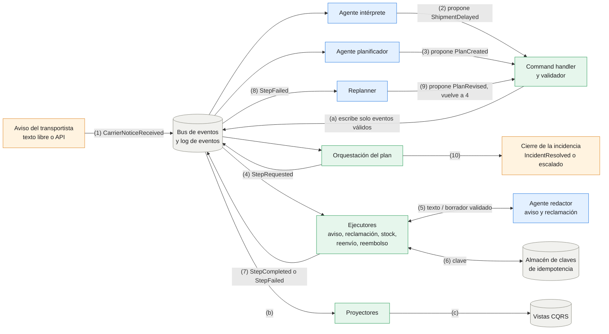
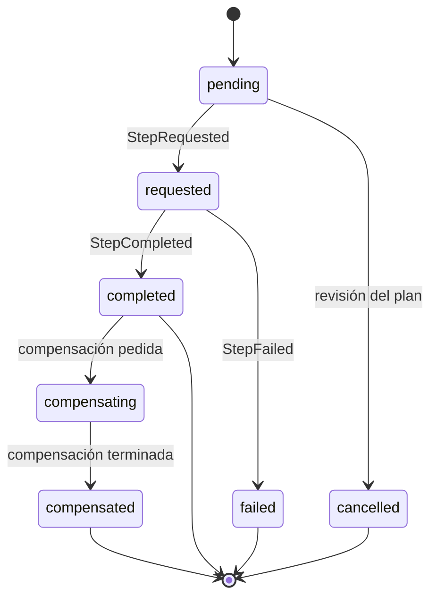
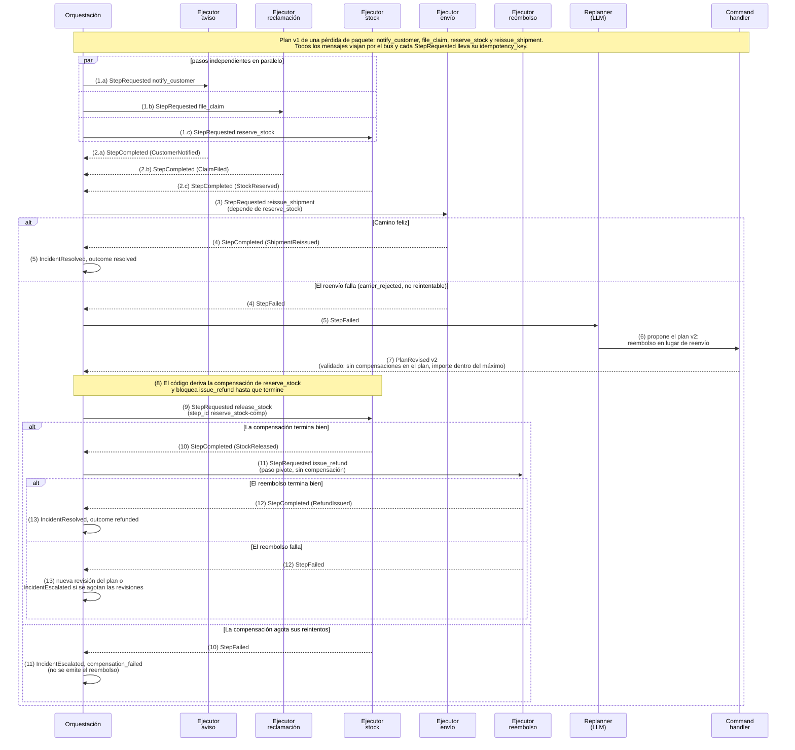
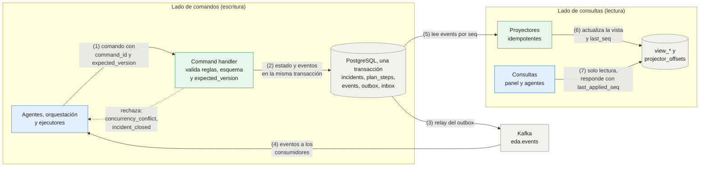

# Guía de la PoC EDA con agentes: propósito y diseño

Gestión de incidencias logísticas con agentes sobre una arquitectura orientada a eventos

## Índice

1. Propósito de la PoC
2. El caso: incidencias logísticas
3. Principios de diseño
4. Arquitectura
5. Eventos y comandos
6. Escritura fiable: transacción, outbox e inbox
7. Idempotencia
8. Planning y saga
9. CQRS: vistas y consultas
10. Fronteras del LLM
11. Resiliencia
12. Observabilidad y auditoría
13. Datos sintéticos e inyección de fallos
14. Experimentos
15. Decisiones asumidas y límites
16. Mapa del repositorio

Esta guía amplía el resumen de `README.md`. Explica para qué sirve la PoC y cómo está diseñada, con el razonamiento de cada decisión. Las especificaciones normativas (requisitos SHALL/MUST y escenarios) están en `specs/`, y el detalle de implementación (tablas, flujos, configuración) en `design.md`. Si algo de esta guía contradice una spec, manda la spec.

## 1. Propósito de la PoC

### 1.1 Qué se quiere averiguar

Los agentes con LLM se suelen construir como llamadas encadenadas: un componente llama al siguiente y espera. Funciona en una demostración, pero en producción aparecen problemas conocidos: un fallo a mitad de cadena deja el trabajo a medias, un reintento repite un efecto (dos reembolsos, dos correos), nadie sabe después por qué el sistema decidió algo, y cada cambio toca a todos los componentes.

La arquitectura orientada a eventos (EDA) promete resolverlos: los componentes se comunican con hechos inmutables a través de un bus, y el log de hechos es la fuente de verdad. Esta PoC pone a prueba esa promesa aplicada a agentes. La pregunta de investigación es:

> ¿Qué ganan en fiabilidad, recuperación y auditabilidad los agentes con LLM cuando se organizan sobre eventos, qué cuesta en complejidad, latencia y coste, y qué patrones hacen falta para que funcione?

### 1.2 Qué patrones ejercita

La PoC no pretende mostrar todos los patrones de la guía «Patrones aplicados al desarrollo de agentes», sino un conjunto que se apoya mutuamente. El eje es CQRS (separar quien escribe de quien consulta), con Planning orientado a eventos e idempotencia como segundo y tercer foco:

| Patrón | Para qué sirve aquí |
| --- | --- |
| CQRS | Separar el command handler (escribe) de las vistas (leen) y poder reconstruir las vistas desde el log |
| Planning orientado a eventos y Plan-and-Execute | Un plan versionado cuyos pasos independientes se ejecutan en paralelo y se revisa cuando algo falla |
| Saga y compensación | Deshacer lo ya hecho cuando el plan cambia, sin que el LLM decida cómo |
| Outbox, inbox e Idempotency key | Que ningún evento se pierda y ningún efecto se repita, aunque el bus entregue duplicados |
| Control optimista de concurrencia | Evitar que dos componentes modifiquen a la vez la misma incidencia |
| Retry con backoff y dead letter, backpressure | Sobrevivir a fallos parciales sin perder trabajo |
| Guardrails y bounded autonomy | Fijar lo que el LLM puede proponer y lo que decide el código |
| Tracing distribuido y auditoría | Explicar cada decisión a partir del log |
| Evals como quality gates | Medir con umbrales si el sistema cumple |

### 1.3 Qué entrega la PoC

- Un sistema ejecutable de agentes dirigidos por eventos, con una versión síncrona equivalente como línea base.
- Siete experimentos (E1 a E7) con hipótesis medibles y un informe reproducible por experimento.
- Un diseño documentado que se pueda discutir y criticar: especificaciones, diagramas y decisiones explícitas.

### 1.4 Qué no es

No es un producto ni un benchmark de rendimiento a gran escala. Corre en una máquina, con un broker, un relay y servicios externos simulados. Sirve para comparar **comportamientos** (qué pasa ante duplicados, caídas o fallos de un paso) y **costes relativos**, no para dimensionar un despliegue real. La sección 15 recoge los límites con más detalle.

## 2. El caso: incidencias logísticas

Una tienda online recibe avisos de los transportistas: retrasos, pérdidas, daños, direcciones erróneas, huelgas. Llegan en texto libre o por API. Ante cada aviso hay que decidir qué hacer y hacerlo: avisar al cliente, reclamar al transportista, reservar stock en otro almacén, reenviar el pedido o reembolsarlo.

Se eligió este caso por tres motivos. Tiene decisiones que requieren lenguaje natural (interpretar el aviso, redactar un mensaje, planificar), lo que justifica el LLM. Tiene efectos con consecuencias económicas reales (un reembolso duplicado cuesta dinero), lo que hace relevantes la idempotencia y los guardrails. Y combina pasos que se pueden deshacer (una reserva de stock) con otros que no (un reembolso), lo que obliga a pensar la saga.

### 2.1 Ejemplo recorrido: pérdida de paquete

1. El transportista avisa de que un paquete se ha perdido. Entra como `CarrierNoticeReceived`.
2. El **agente intérprete** extrae pedido, causa (`loss`), retraso estimado y gravedad, y propone `ShipmentDelayed`. El command handler lo valida y lo escribe.
3. El **agente planificador** propone el plan v1: avisar al cliente, reclamar al transportista, reservar stock en otro almacén y reenviar el pedido (el reenvío depende de la reserva).
4. La **orquestación** emite en paralelo los pasos independientes (aviso, reclamación, reserva). Cuando la reserva termina, emite el reenvío.
5. Supongamos que el transportista rechaza el reenvío (`carrier_rejected`, no reintentable). El **replanner** propone el plan v2: reembolsar en lugar de reenviar.
6. El **código** (no el LLM) detecta que el reenvío cancelado dependía de una reserva ya completada y deriva su compensación: liberar el stock. Solo cuando termina, se emite el reembolso, que es el paso pivote.
7. La incidencia se cierra con `IncidentResolved` (resultado `refunded`). Si algo se agota por el camino, se escala a una persona con `IncidentEscalated` y su motivo.

Todo lo anterior queda en el log como hechos encadenados. Ese hilo es lo que permite reconstruir qué ocurrió y por qué.

## 3. Principios de diseño

Las decisiones del resto del documento salen de estos principios. Si hay duda, se vuelve a ellos.

1. **El LLM propone y el código dispone.** Un agente con LLM nunca escribe en el log ni ejecuta efectos. Produce una propuesta que el código valida con un esquema y con reglas de negocio. Es la idea central: el LLM aporta juicio sobre lenguaje y planificación, y el código aporta las garantías.
2. **Los hechos son inmutables.** El log `events` solo admite inserciones. Un error se corrige con un evento posterior, nunca editando el pasado.
3. **El estado y el evento se escriben juntos o no se escriben.** Si un componente cambia su estado, el evento correspondiente y su salida al bus van en la misma transacción.
4. **Todo puede llegar dos veces.** El bus entrega al menos una vez; por tanto, todo consumidor es idempotente.
5. **Escribir y leer son modelos distintos.** Las consultas leen vistas derivadas, nunca el estado de escritura ni el log.
6. **Lo que no se puede deshacer se hace el último.** Las compensaciones las deriva el código, y el paso irreversible (el reembolso) espera a que no queden compensaciones pendientes.
7. **Lo que entra de fuera no es de fiar.** El texto de un aviso puede contener instrucciones; se trata como dato, no como orden.
8. **Todo es medible.** Cada hipótesis tiene un experimento, una métrica y un umbral.

## 4. Arquitectura

### 4.1 Vista general

El diagrama muestra los agentes y el flujo de eventos. En azul están los agentes con LLM, que proponen; en verde, el código determinista, que dispone; en gris, los datos; en naranja, la entrada y la salida. Los pasos (1) a (10) siguen una incidencia; (a) a (c) son la escritura validada y la proyección de las vistas.



### 4.2 Componentes

Cada componente es un proceso Python independiente, con su propio grupo de consumidores en Kafka y su propio nombre en el inbox. Se pueden reiniciar o escalar por separado.

| Componente | Consume | Produce | Naturaleza |
| --- | --- | --- | --- |
| `interpreter` | `CarrierNoticeReceived` | `ShipmentDelayed` | LLM más command handler |
| `planner` | `ShipmentDelayed` | `PlanCreated` | LLM más command handler |
| `orchestrator` | `PlanCreated`, `PlanRevised`, `StepCompleted`, `StepFailed` | `StepRequested`, `IncidentResolved`, `IncidentEscalated` | Código |
| `replanner` | `StepFailed` | `PlanRevised` | LLM más command handler |
| `executor-<acción>` | `StepRequested` de su acción | `StepCompleted`, `StepFailed` y el evento de efecto | Código |
| `projectors` | el log, por `seq` | Vistas `view_*` | Código |
| `relay` | tabla `outbox` | Mensajes a Kafka | Código |

El agente redactor (que escribe el texto de los avisos al cliente y de las reclamaciones) no es un proceso aparte: lo invoca el ejecutor correspondiente, y su borrador pasa por validación antes de usarse.

### 4.3 Dónde vive cada cosa

| Concepto | Dónde |
| --- | --- |
| Log de eventos (fuente de verdad) | Tabla `events` de PostgreSQL, solo de añadir |
| Bus de entrega | Topic `eda.events` de Kafka, 3 particiones, clave `incident_id` |
| Outbox | Tabla `outbox`, escrita junto al estado y al evento |
| Inbox | Tabla `inbox (consumer, event_id)` |
| Claves de idempotencia | Tabla `effect_keys` |
| Estado de escritura | Tablas `incidents`, `plan_steps`, `carrier_notices` |
| Vistas de lectura | Tablas `view_*` y `projector_offsets` |
| Dead letters | Topic `eda.dlq` y tabla `dead_letters` |
| Negocio simulado | `orders`, `stock`, `reservations`, `claims`, `refunds`, `customer_messages` |

### 4.4 Por qué PostgreSQL es el log y Kafka solo el bus

Es la decisión de diseño más discutible y conviene explicarla. Se podría usar el propio Kafka como log. Se ha preferido PostgreSQL por tres razones:

- **Atomicidad.** El estado, el evento y el outbox se escriben en una sola transacción local. Con Kafka como único log haría falta coordinar dos sistemas.
- **Reconstrucción.** Los proyectores leen de la tabla `events` por `seq`. Reconstruir una vista no depende de cuánto retenga el broker.
- **Simplicidad.** Un broker, una base de datos y un relay bastan para una PoC.

La consecuencia es que Kafka es prescindible: si se pierde un topic, el relay lo republica desde `events`. El precio es que existe un proceso extra, el relay, y que la latencia incluye un salto por el outbox.

### 4.5 Pila tecnológica

| Pieza | Decisión |
| --- | --- |
| Lenguaje | Python 3.12 |
| Broker | Apache Kafka (imagen `apache/kafka`, modo KRaft, un broker), en Docker |
| Base de datos | PostgreSQL 16 en Docker, con volumen persistente |
| Clientes | `confluent-kafka` y `psycopg` 3 |
| Esquemas | `pydantic`, para eventos y salidas del LLM |
| LLM | SDK de Anthropic tras una interfaz `LlmClient`, con una implementación simulada para tests |
| Tests | `pytest`, con PostgreSQL y Kafka reales en Docker en los de integración |

La interfaz `LlmClient` permite ejecutar los experimentos deterministas (E1 a E4, E7) sin coste de tokens y reservar el LLM real para los que lo necesitan (E5, E6).

## 5. Eventos y comandos

### 5.1 Evento y comando son cosas distintas

Un **evento** es un hecho ya ocurrido, con el verbo en pasado (`PlanCreated`). Se guarda y no se discute. Un **comando** es una petición con destinatario, en imperativo (`CreatePlan`), que puede ser rechazada. Los comandos solo existen dentro del command handler; lo que se publica y se guarda son los eventos.

### 5.2 Estructura común del evento

Todo evento lleva los mismos campos de envoltura, y el sistema rechaza publicar uno al que falte alguno:

| Campo | Significado |
| --- | --- |
| `event_id` | Identificador único del evento |
| `event_type` | Tipo, por ejemplo `StepRequested` |
| `event_version` | Versión del esquema del tipo |
| `occurred_at` | Marca de tiempo |
| `correlation_id` | El `incident_id`: agrupa todos los eventos de una incidencia |
| `causation_id` | El `event_id` del evento que originó este |
| `producer` | Componente que lo produjo |
| `payload` | Datos propios del tipo |

La pareja `correlation_id` y `causation_id` forma el hilo que enlaza las decisiones. Es la base de la traza (sección 12) y del experimento de auditabilidad (E7).

### 5.3 Catálogo de eventos

| Evento | Lo produce | Significado |
| --- | --- | --- |
| `CarrierNoticeReceived` | Entrada | Llegó un aviso del transportista |
| `ShipmentDelayed` | Intérprete | Se abre la incidencia con causa y gravedad |
| `PlanCreated` | Planificador | Plan v1 con sus pasos |
| `PlanRevised` | Replanner | Nueva versión del plan tras un fallo |
| `StepRequested` | Orquestación | Se pide ejecutar un paso, con su `idempotency_key` |
| `StepCompleted` / `StepFailed` | Ejecutor | Resultado del paso |
| `CustomerNotified`, `ClaimFiled`, `StockReserved`, `StockReleased`, `ShipmentReissued`, `RefundIssued` | Ejecutor | El efecto concreto que se produjo |
| `IncidentResolved` / `IncidentEscalated` | Orquestación | Cierre, o paso a una persona con su motivo |

### 5.4 Catálogo de comandos

| Comando | Lo envía | Eventos que puede producir |
| --- | --- | --- |
| `RegisterCarrierNotice` | Entrada | `CarrierNoticeReceived` |
| `OpenIncident` | Intérprete | `ShipmentDelayed` |
| `CreatePlan` | Planificador | `PlanCreated` |
| `RevisePlan` | Replanner | `PlanRevised` y las compensaciones derivadas |
| `RequestStep` | Orquestación | `StepRequested` |
| `RecordStepResult` | Ejecutores | `StepCompleted` o `StepFailed`, y el evento de efecto |
| `CloseIncident` | Orquestación | `IncidentResolved` |
| `EscalateIncident` | Cualquiera | `IncidentEscalated` |

Todos llevan `command_id` y `expected_version` (sección 9.2).

### 5.5 Versionado y datos personales

Cada tipo tiene un `event_version`. Un cambio incompatible incrementa la versión, y los consumidores aceptan las anteriores mediante un conversor al leer, sin reescribir el log. Los eventos **no contienen datos personales** en claro: llevan referencias (`order_id`, `customer_ref`) que el ejecutor resuelve en el momento de actuar. Así el log, que es inmutable, no acumula datos que luego haya que borrar.

## 6. Escritura fiable: transacción, outbox e inbox

### 6.1 El problema de la doble escritura

Un componente que cambia su estado y publica un evento hace dos escrituras en sistemas distintos. Si cae entre una y otra, o se pierde el evento o se publica un hecho que no se confirmó. El patrón **outbox** lo resuelve: el evento no se publica directamente, sino que se escribe en una tabla de la misma base de datos, en la misma transacción que el cambio de estado, y un proceso aparte (el relay) lo lleva a Kafka.

### 6.2 La transacción de escritura

Toda escritura de un componente es una única transacción de PostgreSQL:

```
BEGIN
  1. INSERT INTO inbox (consumer, event_id)
       ON CONFLICT DO NOTHING
       -> si no inserta fila: duplicado, terminar
  2. validar la propuesta
  3. actualizar el estado (incidents, plan_steps)
  4. INSERT INTO events (...)
  5. INSERT INTO outbox (seq)
COMMIT
confirmar el offset en Kafka
```

La llamada al LLM se hace **antes** de abrir la transacción. Así no se mantiene una transacción abierta durante segundos y, si el proceso cae entre la llamada y el `COMMIT`, el evento se reentrega y se repite la llamada. Cuesta tokens, pero no produce efectos duplicados.

### 6.3 El relay

El relay es un proceso con polling, sin Debezium. Lee las filas de `outbox` sin publicar, las manda a `eda.events` con `acks=all` e idempotencia activada, y marca `published_at`. Garantías y límites:

- **Al menos una vez.** Si cae tras producir y antes de marcar, republica. Los duplicados los absorbe el inbox.
- **Orden por incidencia.** Lee por `seq` y Kafka conserva el orden dentro de una partición; la clave de partición es el `incident_id`.
- **Un solo relay.** Con varios, `SKIP LOCKED` podría intercalar lotes y romper el orden. Para la PoC basta uno.
- **Republicación.** `relay --replay-from <seq>` vuelve a enviar desde un punto, útil si se pierde un topic.

### 6.4 Consumidores y offsets

Los consumidores desactivan el commit automático y confirman el offset de Kafka **solo después del `COMMIT` de PostgreSQL**. Dos casos:

- Cae después del `COMMIT` y antes de confirmar el offset: Kafka reentrega y el inbox descarta el duplicado.
- Cae antes del `COMMIT`: no hay offset confirmado, se reintenta con backoff exponencial y jitter.

No se usan transacciones de Kafka ni exactly-once. Se asume entrega al menos una vez y se absorben los duplicados en la aplicación. Es una decisión deliberada: es lo que se hace en la práctica y es lo que el experimento E1 pone a prueba.

## 7. Idempotencia

### 7.1 Dos capas, dos problemas

La confusión más habitual es creer que una sola tabla resuelve la idempotencia. Hay dos problemas distintos:

| Mecanismo | Pregunta que responde | Clave | Protege |
| --- | --- | --- | --- |
| Inbox | ¿Este consumidor ya procesó este evento? | `(consumer, event_id)` | El procesamiento: estado, vistas, eventos derivados |
| `effect_keys` | ¿Este efecto ya se ejecutó? | `idempotency_key` | Los efectos: correos, reclamaciones, reservas, reembolsos |

Pueden darse por separado. Un mismo efecto puede pedirse en dos `StepRequested` distintos (por ejemplo tras una revisión del plan o una reentrega con otro `event_id`), y el inbox no lo detectaría porque los eventos son diferentes; `effect_keys` sí. Por eso hacen falta las dos.

### 7.2 La clave de idempotencia

```
idempotency_key = hash(incident_id, step_id, plan_version de creación del paso)
```

Lo importante es que usa la versión del plan **en la que se creó el paso**, no la vigente. Así un paso que el replanner mantiene entre versiones conserva su clave y no se ejecuta otra vez. Si se usara la versión vigente, cada revisión cambiaría las claves de todos los pasos y se duplicaría el trabajo ya hecho.

Las compensaciones tienen `step_id` igual al del paso original más el sufijo `-comp`, y su clave se calcula con ese `step_id`. Repetir una compensación no libera dos veces el stock.

### 7.3 Funcionamiento en el ejecutor

```
BEGIN
  inbox (como en 6.2)
  INSERT INTO effect_keys (clave, status='in_progress',
                           locked_until = now() + plazo)
    ON CONFLICT DO NOTHING
  si no inserta fila, leer la existente:
    completed                       -> reutilizar el resultado
    in_progress y bloqueo vigente   -> reintentar más tarde
    in_progress y bloqueo vencido   -> tomar el relevo
  ejecutar el efecto
  UPDATE effect_keys SET status='completed', result=...
  INSERT events (StepCompleted + evento de efecto) + outbox
COMMIT
```

El campo `locked_until` resuelve el caso del ejecutor que cae a mitad: la clave queda `in_progress`, y pasado el plazo otro ejecutor puede tomar el relevo en lugar de bloquear el paso para siempre.

Hay una diferencia importante según dónde ocurra el efecto. Si es una tabla de PostgreSQL (una reserva, un reembolso simulado), se hace en la misma transacción y la garantía es fuerte. Si es un servicio externo simulado (correo, transportista), la transacción no lo cubre; por eso se le envía la misma clave y es el servicio quien deduplica, como haría un proveedor de pagos real.

### 7.4 Segunda línea de defensa

Además, hay restricciones de unicidad que impedirían un duplicado aunque `effect_keys` fallase: `claims (incident_id, order_id)`, `refunds.step_id` y `customer_messages.step_id`. En el experimento E1 se desactivan el inbox y `effect_keys` (con los interruptores `INBOX_ENABLED` y `EFFECT_KEYS_ENABLED`) y, en la base de pruebas, estas restricciones, para medir cuántos duplicados reales se producirían sin protección.

## 8. Planning y saga

### 8.1 El plan

El planificador propone un plan con una versión y una lista de pasos. Cada paso tiene `step_id`, `action`, `params` y `depends_on`. Las acciones permitidas son una lista cerrada: `notify_customer`, `file_claim`, `reserve_stock`, `reissue_shipment`, `release_stock` e `issue_refund`. El LLM no puede inventar acciones.

La gravedad condiciona el plan: para `low` basta un aviso al cliente; desde `medium` se genera un plan completo.

Los pasos cuyas dependencias están cumplidas se emiten **a la vez**. Ninguno se emite con dependencias pendientes. Es lo que hace que el planning orientado a eventos aproveche el paralelismo: el aviso, la reclamación y la reserva no se esperan entre sí.

### 8.2 Revisión del plan

Cuando un paso falla sin posibilidad de reintento, el replanner propone una nueva versión. Dos reglas la acotan:

- No puede incluir pasos ya completados. Se rehace lo que falló, no lo que ya se hizo.
- Debe reutilizar el `step_id` de los pasos que mantiene. Solo los pasos nuevos reciben identificador nuevo.

Los `StepCompleted` y `StepFailed` de una versión anterior a la vigente se ignoran (salvo para auditoría), de modo que un resultado tardío no altera el estado de una incidencia que ya se replanificó.

### 8.3 Estados de un paso



Un paso cancelado por una revisión sin efecto previo pasa a `cancelled`. Uno completado y compensable cuya compensación se pide pasa a `compensating` y, al terminar, a `compensated`.

### 8.4 La saga y las compensaciones

Una saga es una secuencia de pasos donde, si uno falla, se deshace lo anterior con acciones inversas en lugar de con un rollback. En esta PoC, solo una acción tiene inversa:

| Acción | Compensación | Notas |
| --- | --- | --- |
| `notify_customer` | Ninguna | |
| `file_claim` | Ninguna | La reclamación sigue siendo válida aunque se reembolse |
| `reserve_stock` | `release_stock` | La única acción compensable |
| `reissue_shipment` | Ninguna | |
| `issue_refund` | Ninguna | Paso pivote: último, y solo sin compensaciones pendientes |

Al recibir un `PlanRevised`, la orquestación, en una transacción:

1. Marca como `cancelled` los pasos pendientes que el plan nuevo no mantiene.
2. Para cada paso completado y compensable cuyo dependiente se ha cancelado, crea un paso `<original>-comp`, marca el original como `compensating` y emite su `StepRequested`.
3. Retiene `issue_refund` hasta que no queden pasos `compensating`.

Las compensaciones se ejecutan en orden inverso a los pasos originales. Si una agota sus reintentos, la incidencia se escala con el motivo `compensation_failed` y **no se emite el reembolso**: es preferible una persona revisando que un reembolso con el stock sin liberar.

### 8.5 Por qué las compensaciones las deriva el código

Dejar que el LLM proponga las compensaciones sería delegar en él una propiedad de corrección: si se le olvida una, hay stock reservado para siempre. Que sean deterministas y que el plan del LLM **no pueda** incluir pasos de compensación (se rechaza con `compensation_not_allowed_in_plan`) hace que la corrección de la saga no dependa de la calidad del modelo.

### 8.6 Secuencia completa

El diagrama recorre el ejemplo de la sección 2: camino feliz, fallo del reenvío con reembolso tras compensar, y los dos fallos posibles que escalan.



## 9. CQRS: vistas y consultas

### 9.1 Separar escritura y lectura

El lado de **comandos** acepta cambios: el command handler valida las reglas contra el estado actual y, si se cumplen, escribe estado y eventos en una transacción. El lado de **consultas** responde preguntas leyendo vistas construidas a partir del log. Son modelos distintos con tablas distintas, y los componentes de lectura no leen el estado de escritura ni hacen joins con él.



Los pasos (1) a (4) son el camino de escritura y (5) a (7), el de lectura. Es importante que los agentes que necesitan el estado de una incidencia para decidir lo consulten en las vistas, y que los que validan una escritura usen el command handler: son dos preguntas distintas («¿cómo está?» frente a «¿puedo hacer esto?») con garantías distintas.

### 9.2 Concurrencia optimista

Dos componentes pueden intentar cambiar la misma incidencia a la vez (por ejemplo, el replanner y el orquestador). Cada incidencia tiene un número `version`, y todo comando indica la `expected_version`. El command handler ejecuta:

```
UPDATE incidents SET version = version + 1
 WHERE incident_id = ? AND version = ?
```

Si no actualiza ninguna fila, rechaza el comando con `concurrency_conflict` y no escribe nada. El componente relee el estado y reintenta. No hay bloqueos largos, y un comando basado en información vieja no pasa.

### 9.3 CQRS sin event sourcing puro

Se ha separado CQRS de event sourcing a propósito. El estado de escritura (`incidents`, `plan_steps`) vive en tablas y se actualiza junto con el log. El log sirve para reconstruir las vistas y para auditar, pero **no** se rehidrata el estado de escritura a partir de él. Es más sencillo y más rápido de leer, a costa de que haya dos representaciones del estado que deben mantenerse coherentes (la transacción única lo garantiza).

### 9.4 Las vistas

| Vista | Qué responde |
| --- | --- |
| `incident_status` | Estado y paso actual de cada incidencia, y el motivo si está escalada |
| `cost_per_incident` | Tokens, coste estimado del LLM y coste de los efectos por incidencia |
| `audit_trail` | Quién decidió qué, con qué versión del plan y con qué validación |
| `carrier_dashboard` | Retrasos y reclamaciones por transportista |

Añadir una vista nueva no exige cambiar el command handler ni los eventos existentes: es el beneficio principal de CQRS en este diseño.

### 9.5 Proyectores

Cada proyector lee de `events` por `seq` (no de Kafka), aplica los eventos a su vista de forma idempotente y actualiza su posición en `projector_offsets` **en la misma transacción** que la vista. Por eso no necesita inbox: si repite un evento, la vista queda igual.

Reconstruir una vista es vaciar sus tablas y poner `last_seq = 0`. El experimento E4 comprueba que la vista reconstruida es idéntica a la mantenida de forma incremental.

### 9.6 Consistencia eventual declarada

Las vistas van por detrás del log. Cada respuesta de consulta incluye `last_applied_seq`, el último `seq` que aplicó el proyector, para que quien consulta sepa cuán actual es lo que ve. No se oculta el desfase: se mide y se expone.

## 10. Fronteras del LLM

La confianza en un sistema con LLM no viene del modelo, sino de lo que lo rodea. Las reglas son:

| Regla | Cómo se aplica |
| --- | --- |
| Salida con esquema | Toda salida (incidencia, plan, borrador) se valida con `pydantic` antes de convertirse en evento. Una salida inválida se descarta y no entra en el log |
| Sin efectos | Los agentes con LLM no tienen herramientas con efectos. Solo los ejecutores actúan sobre sistemas externos |
| Reglas de negocio en código | El importe máximo de reembolso, las acciones permitidas y los umbrales de gravedad los comprueba el código, aunque el LLM justifique lo contrario |
| Generación acotada | Si una salida es rechazada, se pide de nuevo un número limitado de veces; agotado, se escala con `llm_output_invalid` |
| Presupuesto por incidencia | Cada incidencia tiene un tope de tokens, de llamadas y de revisiones del plan; al agotarlo se escala con `budget_exhausted` |
| Entrada no confiable | El texto del aviso es un dato. El intérprete no tiene herramientas con efectos y ignora las instrucciones que contenga |
| Escalado a una persona | Una incidencia escalada se ve en `incident_status` con su motivo y no se reintenta de forma automática |

El efecto práctico es que un modelo equivocado, o un aviso malicioso, puede producir como mucho una propuesta rechazada o una incidencia escalada, no un reembolso indebido.

## 11. Resiliencia

| Situación | Respuesta del diseño |
| --- | --- |
| Error transitorio de un paso | Reintento con espera exponencial y jitter hasta un máximo; los errores no reintentables no se reintentan |
| Evento irrecuperable (esquema inválido, plan imposible) | Va a `eda.dlq` y a `dead_letters` con su motivo y `correlation_id`, y se escala la incidencia si estaba abierta. No se descarta en silencio |
| Caída de un consumidor | Retoma desde su último offset confirmado; ninguna incidencia queda sin procesar y ningún paso completado se repite |
| Reinicio del orquestador | Recupera la versión vigente y los pasos pendientes de cada incidencia a partir del estado y del log, sin depender de memoria local |
| Pico de carga | Cada ejecutor limita sus operaciones simultáneas; el resto espera en el bus sin perderse |
| Ejecutor lento o caído | No impide que los demás procesen sus pasos: cada acción tiene su propio consumidor |

Las dos propiedades que sostienen todo lo demás son que el offset se confirma tras el `COMMIT` y que los consumidores son idempotentes: juntas hacen que reintentar sea siempre seguro.

## 12. Observabilidad y auditoría

Se genera una traza por incidencia, identificada por su `incident_id`, con un span por cada llamada al LLM, evento consumido y efecto ejecutado, enlazados por `causation_id`. Cada llamada al LLM se registra con el agente, el modelo, los tokens de entrada y salida, la latencia y si la salida superó la validación, sin datos personales.

Dos vistas dependen de esto:

- **`cost_per_incident`** suma tokens, coste del LLM y coste de los efectos, lo que permite saber cuánto cuesta cada incidencia y qué parte es lenguaje y qué parte es negocio.
- **`audit_trail`** explica cada decisión: qué agente propuso qué, con qué versión del plan, qué validación aplicó el código y por qué se aceptó o rechazó.

El registro de auditoría se deriva **solo del log**. Si se pierde, se reconstruye reproduciéndolo. El experimento E7 lo comprueba pidiendo explicar incidencias elegidas al azar usando solo el log y la traza.

## 13. Datos sintéticos e inyección de fallos

No hay datos reales. Un generador produce avisos de las seis causas (`delay`, `loss`, `damage`, `wrong_address`, `strike`, `unknown`), en texto libre y en formato de API, cada uno con la causa y el plan esperados como etiqueta. Con la misma semilla produce siempre el mismo conjunto, lo que hace los experimentos repetibles.

Los pedidos, el stock por almacén, los transportistas, el correo y los pagos son simulados. Sobre ellos se pueden inyectar fallos, también deterministas dada una semilla:

- Duplicar eventos de 1 a N veces.
- Retrasar su entrega.
- Hacer fallar un tipo de paso con una probabilidad dada.
- Caer un consumidor en un instante concreto.
- Dejar sin stock un almacén.

## 14. Experimentos

Cada experimento se ejecuta con un único comando y genera un informe con la semilla, la configuración, la versión de los prompts y de los modelos y las métricas. Los que dependen del LLM (E5 y E6) se repiten al menos tres veces y el informe muestra la variación.

| Experimento | Qué hace | Hipótesis y métrica |
| --- | --- | --- |
| E1 Duplicados en el bus | Entrega cada evento 2 y 3 veces, con y sin idempotencia | H1: con idempotencia, 0 efectos duplicados; sin ella, más de 0 |
| E2 Caída de un ejecutor | Mata un ejecutor a mitad de un plan y lo reinicia | H2: el 100 % de los planes termina sin repetir pasos completados |
| E3 Fallo de un paso | Deja sin stock el almacén en parte de las incidencias | H3: el replanner nunca repite pasos hechos y respeta el límite de reembolso |
| E4 Reconstrucción de vistas | Borra cada vista y la reconstruye desde el log | H4: la huella coincide con la original; se mide el tiempo |
| E5 Calidad del plan | Compara el plan con el esperado en 30 a 50 incidencias etiquetadas | H5: acierto en la selección de acciones de al menos el 80 % (valor inicial) |
| E6 Eventos frente a síncrono | Compara ambas versiones en latencia, tokens, coste y comportamiento ante fallos | H6: sin umbral; se mide y se describe con media, mediana y percentil 95 |
| E7 Auditabilidad | Explica incidencias al azar solo con el log y la traza | H7: el 100 % tiene agente, versión del plan y motivo para cada decisión |

La **base síncrona** del experimento E6 usa la misma lógica de negocio, los mismos agentes con LLM y los mismos ejecutores, pero con llamadas directas en lugar de bus, log y vistas, y los mismos datos y fallos. Es lo que permite atribuir las diferencias a la arquitectura y no a otra cosa.

## 15. Decisiones asumidas y límites

### 15.1 Decisiones asumidas

Se tomaron sin que estuvieran cerradas de antemano y se pueden cambiar sin tocar el resto:

- **Umbrales numéricos** de las hipótesis (por ejemplo el 80 % de E5): son valores iniciales míos, ajustables.
- **Clave de idempotencia con la versión de creación del paso**, que afina la fórmula `hash(incident_id, plan_version, step_id)` del documento de casos de negocio.
- **Una única acción compensable** (`reserve_stock`), con `issue_refund` como paso pivote.
- **CQRS sin event sourcing puro** (sección 9.3).
- **PostgreSQL como log y Kafka como bus** (sección 4.4).
- **Servicios externos simulados:** correo, transportista, almacén y pagos.

### 15.2 Límites: qué no demuestra la PoC

- **Escala.** Un broker, un relay, una máquina. No dice nada sobre el comportamiento con millones de eventos ni sobre cómo escalar el relay.
- **Servicios externos reales.** Los simulados son más amables que los reales: no tienen latencias impredecibles ni semánticas de idempotencia propias.
- **Variabilidad del LLM.** Los resultados de E5 y E6 dependen del modelo y de los prompts; por eso se repiten tres veces, y aun así no generalizan a otros modelos.
- **Datos sintéticos.** Los avisos generados son más limpios que los reales; la calidad del intérprete en producción sería menor.
- **Exactly-once.** No se persigue. Se demuestra que entrega al menos una vez más idempotencia da el mismo resultado observable, no que el bus entregue una sola vez.
- **Seguridad completa.** Se trata la inyección de instrucciones en el texto del aviso, pero no hay autenticación, autorización ni cifrado, que no son el objeto del estudio.

### 15.3 Amenazas a la validez

Una conclusión del tipo «EDA es más fiable» exige cautela: la versión síncrona se escribe con las mismas ganas que la de eventos, pero quien la escribe conoce ya el diseño de eventos. Para reducir el sesgo, ambas comparten ejecutores y lógica de negocio, y los experimentos usan las mismas entradas y los mismos fallos.

## 16. Mapa del repositorio

| Ruta | Contenido |
| --- | --- |
| `docs/README.md` | Resumen: contexto, catálogos, decisiones y experimentos |
| `docs/guia-poc-eda-incidencias.md` | Esta guía |
| `docs/diagrama-*.pdf` | Diagramas de agentes, saga y CQRS en vector |
| `design.md` | Diseño técnico: componentes, flujos, configuración de Kafka |
| `specs/<capacidad>/spec.md` | Requisitos SHALL/MUST con escenarios GIVEN/WHEN/THEN |
| `db/init/001_schema.sql` | Esquema de PostgreSQL |
| `docker-compose.yml` | Kafka (KRaft) y PostgreSQL con volumen |
| `src/eda_retail/` | Código: `events`, `infra`, `llm`, `agents`, `command`, `orchestrator`, `executors`, `projectors`, `synthetic`, `baseline_sync` |
| `experiments/` | Experimentos E1 a E7 con su informe |
| `tests/` | Un test por escenario de las specs |
| `CLAUDE.md` | Reglas para trabajar con Claude Code en este repositorio |

Las capacidades de `specs/` son once: `event-backbone`, `incident-interpretation`, `incident-planning`, `step-execution`, `idempotency`, `cqrs-views`, `resilience`, `llm-boundaries`, `observability-audit`, `synthetic-data` y `experiments`.
