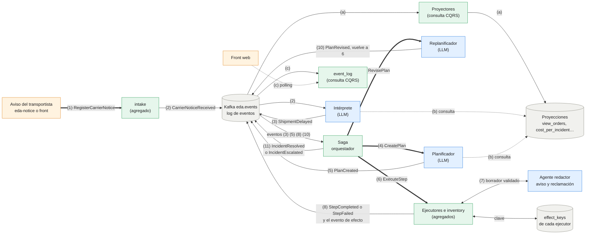
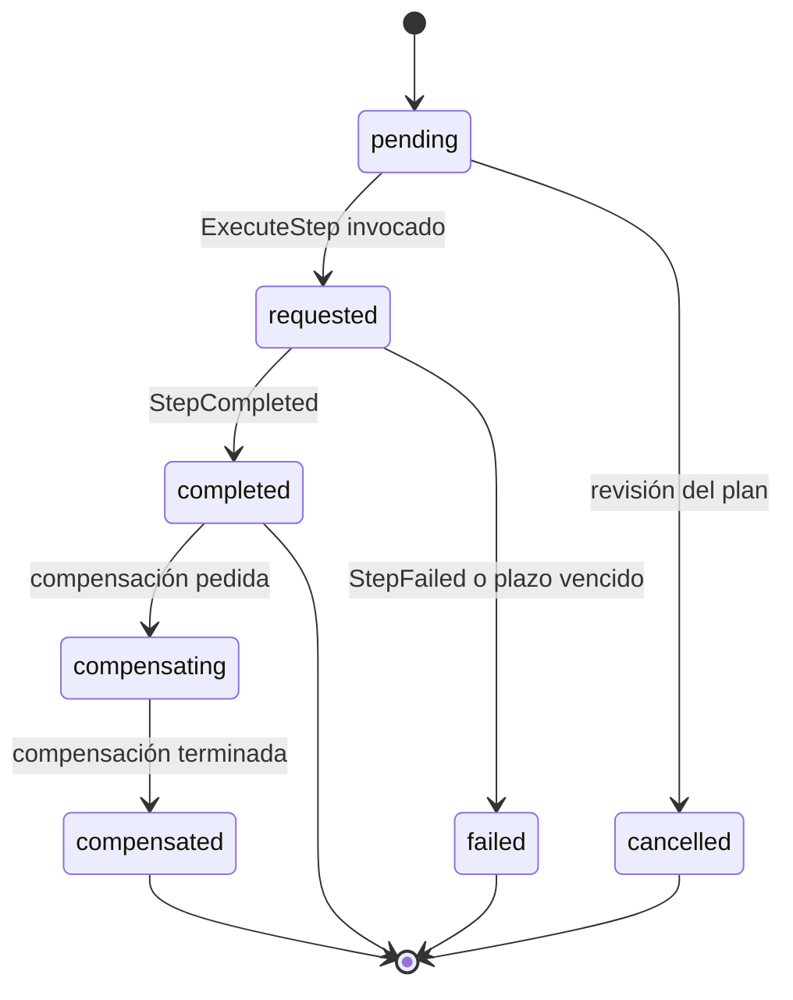
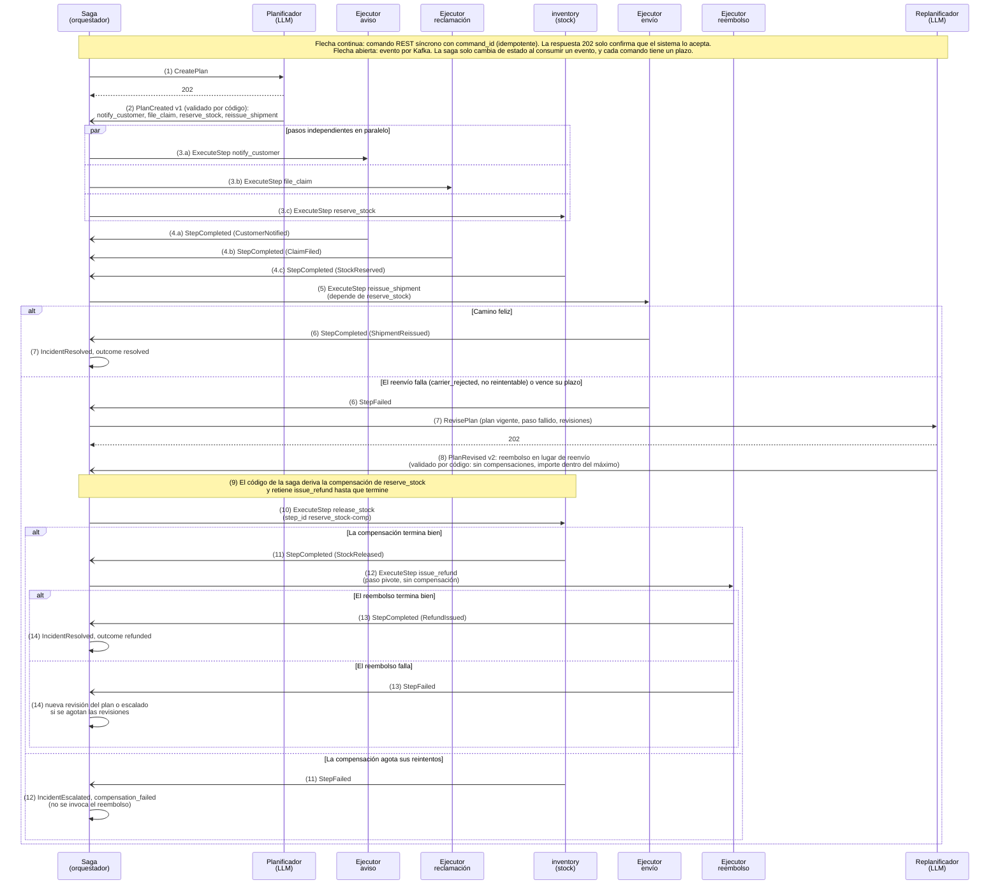
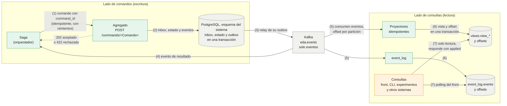
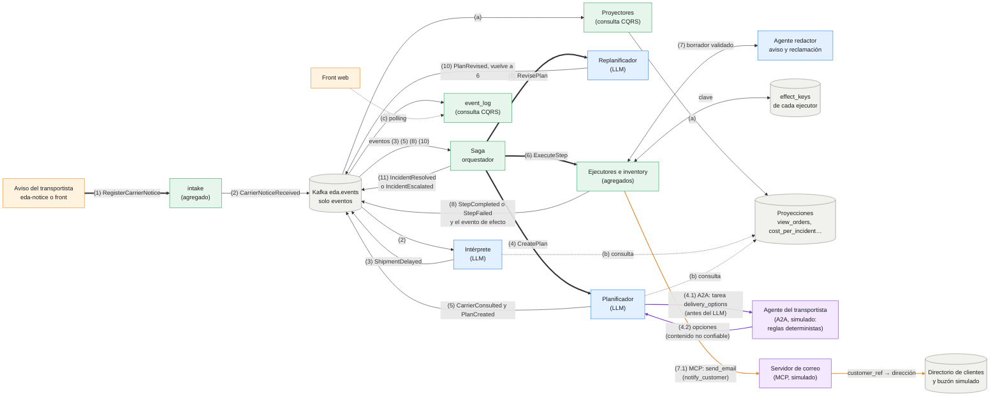
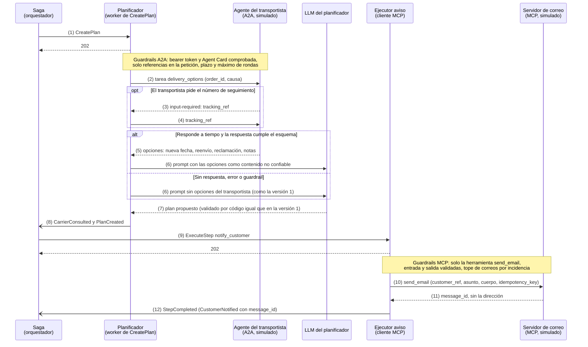

# Guía de la PoC EDA con agentes: propósito y diseño

Gestión de incidencias logísticas con agentes sobre una arquitectura orientada a eventos

## Índice

1. Propósito de la PoC
2. El caso: incidencias logísticas
3. Principios de diseño
4. Arquitectura
5. Eventos y comandos
6. Escritura fiable: transacción, outbox, inbox y comandos
7. Idempotencia
8. Planning y saga
9. CQRS: vistas y consultas
10. Fronteras del LLM
11. Resiliencia
12. Observabilidad y auditoría
13. Datos sintéticos e inyección de fallos
14. Experimentos
15. Decisiones asumidas y límites
16. Segunda versión: MCP y A2A
17. Mapa del repositorio

Esta guía amplía el resumen de `README.md`. Explica para qué sirve la PoC y cómo está diseñada, con el razonamiento de cada decisión. Las especificaciones normativas (requisitos SHALL/MUST y escenarios) están en `specs/`, y el detalle de implementación (tablas, flujos, configuración) en `design.md`. Si algo de esta guía contradice una spec, manda la spec.

> **Estado del documento.** Describe el diseño de `design.md`: el log de eventos vive en Kafka, cada sistema es dueño de sus propios datos y los comandos se invocan por REST. El código ya implementa ese diseño (sección 15.4), segunda versión incluida: MCP y A2A (sección 16) solo se ejecutan si se arranca la PoC con `POC_VERSION=2`.

## 1. Propósito de la PoC

### 1.1 Qué se quiere averiguar

Los agentes con LLM se suelen construir como llamadas encadenadas: un componente llama al siguiente y espera. Funciona en una demostración, pero en producción aparecen problemas conocidos: un fallo a mitad de cadena deja el trabajo a medias, un reintento repite un efecto (dos reembolsos, dos correos), nadie sabe después por qué el sistema decidió algo, y cada cambio toca a todos los componentes.

La arquitectura orientada a eventos (EDA) promete resolverlos: los componentes se comunican con hechos inmutables a través de un bus, y el log de hechos es la fuente de verdad. Esta PoC pone a prueba esa promesa aplicada a agentes. La pregunta de investigación es:

> ¿Qué ganan en fiabilidad, recuperación y auditabilidad los agentes con LLM cuando se organizan sobre eventos, qué cuesta en complejidad, latencia y coste, y qué patrones hacen falta para que funcione?

### 1.2 Qué patrones ejercita

La PoC no pretende mostrar todos los patrones de la guía «Patrones aplicados al desarrollo de agentes», sino un conjunto que se apoya mutuamente. El eje es CQRS (separar quien escribe de quien consulta), con Planning orientado a eventos e idempotencia como segundo y tercer foco:

| Patrón | Para qué sirve aquí |
| --- | --- |
| CQRS | Separar los command handlers (escriben, cada uno en su sistema) de las proyecciones (leen) y poder reconstruirlas volviendo a consumir el log |
| Aggregates (DDD) y datos propios por sistema | Que cada sistema valide sus invariantes, sea el único que escribe su estado y solo se comunique por eventos y comandos |
| Planning orientado a eventos y Plan-and-Execute | Un plan versionado cuyos pasos independientes se ejecutan en paralelo y se revisa cuando algo falla |
| Saga y compensación | Un process manager reactivo que deshace lo ya hecho cuando el plan cambia, sin que el LLM decida cómo |
| Outbox, inbox e Idempotency key | Que ningún evento se pierda y ningún efecto se repita, aunque el bus entregue duplicados |
| Consistencia eventual declarada | Que cada sistema trate de forma explícita que ve a los demás con retraso |
| Retry con backoff y dead letter, backpressure | Sobrevivir a fallos parciales sin perder trabajo |
| Guardrails y bounded autonomy | Fijar lo que el LLM puede proponer y lo que decide el código |
| Tracing distribuido y auditoría | Explicar cada decisión a partir del log |
| MCP y A2A (versión 2) | Cubrir los demás modos de comunicación de un sistema con agentes: herramientas (MCP) y agentes externos (A2A), con guardrails (sección 16) |
| Evals como quality gates | Medir con umbrales si el sistema cumple |

### 1.3 Qué entrega la PoC

- Un sistema ejecutable de agentes dirigidos por eventos, con una versión síncrona equivalente como línea base.
- Siete experimentos (E1 a E7) con hipótesis medibles y un informe reproducible por experimento.
- Un diseño documentado que se pueda discutir y criticar: especificaciones, diagramas y decisiones explícitas.

### 1.4 Qué no es

No es un producto ni un benchmark de rendimiento a gran escala. Corre en una máquina, con un broker, una instancia de PostgreSQL, un relay por componente y servicios externos simulados. Sirve para comparar **comportamientos** (qué pasa ante duplicados, caídas o fallos de un paso) y **costes relativos**, no para dimensionar un despliegue real. La sección 15 recoge los límites con más detalle.

## 2. El caso: incidencias logísticas

Una tienda online recibe avisos de los transportistas: retrasos, pérdidas, daños, direcciones erróneas, huelgas. Llegan en texto libre o por API. Ante cada aviso hay que decidir qué hacer y hacerlo: avisar al cliente, reclamar al transportista, reservar stock en otro almacén, reenviar el pedido o reembolsarlo.

Se eligió este caso por tres motivos. Tiene decisiones que requieren lenguaje natural (interpretar el aviso, redactar un mensaje, planificar), lo que justifica el LLM. Tiene efectos con consecuencias económicas reales (un reembolso duplicado cuesta dinero), lo que hace relevantes la idempotencia y los guardrails. Y combina pasos que se pueden deshacer (una reserva de stock) con otros que no (un reembolso), lo que obliga a pensar la saga.

### 2.1 Ejemplo recorrido: pérdida de paquete

1. El transportista avisa de que un paquete se ha perdido. El sistema `intake` registra el aviso y publica `CarrierNoticeReceived`.
2. El **agente intérprete** extrae pedido, causa (`loss`), retraso estimado y gravedad, y propone `ShipmentDelayed`. Su command handler lo valida y lo escribe, junto a su evento, en su propio esquema.
3. La **saga** (el orquestador) reacciona a `ShipmentDelayed` y le pide el plan al planificador con el comando `CreatePlan`. El **agente planificador** propone el plan v1: avisar al cliente, reclamar al transportista, reservar stock en otro almacén y reenviar el pedido (el reenvío depende de la reserva). Su command handler lo valida y publica `PlanCreated`.
4. La saga invoca en paralelo los pasos independientes (aviso, reclamación, reserva) con `ExecuteStep`. Cuando la reserva termina, invoca el reenvío.
5. Supongamos que el transportista rechaza el reenvío (`carrier_rejected`, no reintentable). La saga invoca `RevisePlan` y el **replanner** propone el plan v2: reembolsar en lugar de reenviar.
6. El **código** (no el LLM) detecta que el reenvío cancelado dependía de una reserva ya completada y deriva su compensación: liberar el stock. Solo cuando termina, se invoca el reembolso, que es el paso pivote.
7. La incidencia se cierra con `IncidentResolved` (resultado `refunded`). Si algo se agota por el camino, se escala a una persona con `IncidentEscalated` y su motivo.

Todo lo anterior queda en el log como hechos encadenados. Ese hilo es lo que permite reconstruir qué ocurrió y por qué.

## 3. Principios de diseño

Las decisiones del resto del documento salen de estos principios. Si hay duda, se vuelve a ellos.

1. **El LLM propone y el código dispone.** Un agente con LLM nunca escribe eventos ni ejecuta efectos. Produce una propuesta que el código valida con un esquema y con reglas de negocio. Es la idea central: el LLM aporta juicio sobre lenguaje y planificación, y el código aporta las garantías.
2. **Los hechos son inmutables.** El log de eventos es el topic `eda.events` de Kafka, con retención infinita y solo de añadir. Un error se corrige con un evento posterior, nunca editando el pasado.
3. **Cada sistema es dueño de sus datos.** Cada sistema es un Aggregate (DDD): solo escribe en sus propias tablas, ningún otro sistema las lee ni se relaciona con ellas (ni claves foráneas ni joins), y solo se comunica con los demás por eventos y comandos. Dos sistemas que escriben en las mismas tablas están acoplados por la base de datos, que es justo lo que una EDA quiere evitar.
4. **El estado y su evento se escriben juntos o no se escriben.** Cuando un sistema cambia su estado, el evento correspondiente va a su outbox en la misma transacción, y un relay lo publica en Kafka.
5. **Todo puede llegar dos veces.** El bus entrega al menos una vez y un comando puede reintentarse; por tanto, todo consumidor y todo comando es idempotente.
6. **Escribir y leer son modelos distintos.** Las consultas leen proyecciones, que son modelos de datos propios construidos desde Kafka, nunca las tablas de escritura de otro sistema.
7. **Todo es reactivo y eventualmente consistente.** Nada avanza sondeando ni esperando el estado de otro sistema. Lo que un sistema ve de los demás llega con retraso, y lo que aún no puede hacer lo aparca y lo reanuda al llegar el evento que le faltaba.
8. **Los comandos no viajan por el bus.** La saga los invoca de forma síncrona (REST) y reacciona al evento con el resultado. Si fueran mensajes en el bus, no habría orquestador: sería una coreografía.
9. **Lo que no se puede deshacer se hace el último.** Las compensaciones las deriva el código, y el paso irreversible (el reembolso) espera a que no queden compensaciones pendientes.
10. **Lo que entra de fuera no es de fiar.** El texto de un aviso puede contener instrucciones; se trata como dato, no como orden.
11. **Todo es medible.** Cada hipótesis tiene un experimento, una métrica y un umbral.

## 4. Arquitectura

### 4.1 Vista general

El diagrama muestra los sistemas y el flujo. En azul están los agentes con LLM, que proponen; en verde, el código determinista, que dispone; en gris, los datos; en naranja, la entrada y el front. Los pasos (1) a (11) siguen una incidencia; (a) a (c) son el lado de lectura.



Flecha gruesa: comando REST síncrono e idempotente (`command_id`), que el sistema que lo recibe acepta o rechaza. Flecha fina: evento por Kafka. Punteada: consulta de solo lectura. Cada sistema que recibe un comando lo valida contra su propio estado, y escribe estado y evento en su esquema, en una transacción; su relay publica el evento en Kafka y la saga reacciona cuando le llega. (a) a (c) son el lado de lectura: proyectores y `event_log` consumen Kafka y mantienen sus propias tablas.

### 4.2 Componentes

Cada componente es un proceso Python independiente, con su propio grupo de consumidores en Kafka, su propio esquema en la base de datos y su propio relay (un hilo que publica su outbox). Se pueden reiniciar o escalar por separado. Por Kafka solo viajan eventos; los comandos se invocan por REST.

| Componente | Comandos que atiende (REST) | Eventos que consume | Eventos que produce | Naturaleza |
| --- | --- | --- | --- | --- |
| `intake` | `RegisterCarrierNotice` (de `eda-notice` y del front) | Ninguno | `CarrierNoticeReceived` | Código |
| `inventory` | `SeedSampleData`; `ExecuteStep` de `reserve_stock` y `release_stock` | Ninguno | `OrderRegistered`, `StockReserved`, `StockReleased`, `StepCompleted`, `StepFailed` | Código |
| `interpreter` | `OpenIncident`, que deriva de `CarrierNoticeReceived` | `CarrierNoticeReceived`; `OrderRegistered` (para reanudar avisos aparcados) | `ShipmentDelayed`, `NoticeParked` o `IncidentEscalated`, `LlmCallRecorded` | LLM más su command handler |
| `planner` | `CreatePlan` (acepta y trabaja en un job) | Ninguno | `PlanCreated` o `IncidentEscalated`, `LlmCallRecorded` | LLM más su command handler |
| `orchestrator` (saga) | Ninguno; invoca `CreatePlan`, `RevisePlan` y `ExecuteStep` | `ShipmentDelayed`, `PlanCreated`, `PlanRevised`, `StepCompleted`, `StepFailed`, `IncidentEscalated` | `StepRequested`, `StepCancelled`, `IncidentResolved`, `IncidentEscalated` | Código (process manager) |
| `replanner` | `RevisePlan` | Ninguno | `PlanRevised` o `IncidentEscalated`, `LlmCallRecorded` | LLM más su command handler |
| `executor-<acción>` | `ExecuteStep` de su acción | Ninguno | `StepCompleted`, `StepFailed`, el evento de efecto, `LlmCallRecorded` | Código |
| `event_log` (consulta) | Ninguno | Todos | Ninguno (mantiene la vista del log) | Código |
| `projectors` (consulta) | Ninguno | Los que necesita cada proyección | Ninguno (mantienen sus proyecciones) | Código |

El agente redactor (que escribe el texto de los avisos al cliente y de las reclamaciones) no es un proceso aparte: lo invoca el ejecutor correspondiente, y su borrador pasa por validación antes de usarse.

Dos de los componentes de la tabla no actúan: `event_log` y `projectors` son el **lado de lectura**. Los demás son **Aggregates**: reciben comandos, validan sus invariantes y escriben su estado.

### 4.3 Dónde vive cada cosa

| Concepto | Dónde |
| --- | --- |
| Log de eventos (fuente de verdad) | Topic `eda.events` de Kafka: 3 particiones, clave `incident_id`, retención infinita, solo de añadir |
| Vista del log, para consultarlo | Tabla `event_log.events`, mantenida por el componente `event_log` consumiendo Kafka |
| Outbox | `<componente>.outbox`, escrita junto al estado en la misma transacción |
| Inbox | `<componente>.inbox`, con el `event_id` o el `command_id` ya procesado |
| Claves de idempotencia | `<ejecutor>.effect_keys` y `inventory.effect_keys` |
| Estado de escritura | Las tablas de cada sistema en su esquema: `intake.carrier_notices`, `planner.plans`, `orchestrator.incidents` y `orchestrator.plan_steps`, `inventory.orders`, `stock` y `reservations`, y las de efectos de cada ejecutor |
| Comandos pendientes de la saga y sus plazos | `orchestrator.command_outbox` y `orchestrator.deadlines` |
| Proyecciones | `views.view_*`, con su posición en `views.offsets` (partición y offset de Kafka) |
| Dead letters | Topic `eda.dlq` y `<componente>.dead_letters` |

### 4.4 Por qué Kafka es el log y PostgreSQL solo el almacén de cada sistema

Usar una tabla de PostgreSQL como log común, en la que escriben y leen todos los componentes, sería un antipatrón: la base de datos pasaría a ser el medio de comunicación y todos los sistemas quedarían acoplados a un modelo de datos compartido. Por eso el diseño separa los papeles:

- **Kafka es el log.** El topic `eda.events` guarda todos los eventos con retención infinita. Es el registro del que se reconstruyen las vistas y se audita lo ocurrido.
- **Cada sistema tiene sus datos.** Cada uno guarda su estado, su outbox y su inbox en su propio esquema. Ningún sistema lee ni escribe las tablas de otro: lo que necesita saber del resto lo consulta en una proyección.
- **La atomicidad se mantiene con el outbox.** Estado y evento se escriben en una sola transacción local, y un relay lleva el evento a Kafka. No hace falta coordinar dos sistemas en la escritura, y por eso se conserva el patrón sin compartir tablas.
- **Los lectores consumen Kafka.** `event_log` y los proyectores leen del topic, no de las tablas de otros. Cada uno guarda en su propia base la posición (partición y offset) que ha aplicado.

La PoC usa una única instancia de PostgreSQL por comodidad (vale para una PoC), pero con un esquema por componente y sin relaciones entre esquemas. Un test estático comprueba que ningún componente escribe fuera del suyo. En un despliegue real, cada sistema tendría su propia base de datos.

El precio es más piezas (un relay por componente, un proceso de consulta para el log) y más latencia, porque cada evento pasa por un outbox y por Kafka antes de llegar a quien lo consume. Y una consecuencia que no es un defecto, sino la condición normal de una EDA: la consistencia eventual (sección 9.6).

### 4.5 Pila tecnológica

| Pieza | Decisión |
| --- | --- |
| Lenguaje | Python 3.12 |
| Broker | Apache Kafka (imagen `apache/kafka`, modo KRaft, un broker), en Docker |
| Base de datos | PostgreSQL 16 en Docker, con volumen persistente, y un esquema por componente |
| Migraciones | Alembic; cada componente evoluciona sus tablas sin tocar las de otro |
| Clientes | `confluent-kafka` y `psycopg` 3 |
| Esquemas | `pydantic`, para eventos y salidas del LLM |
| LLM | Un modelo local de Ollama tras una interfaz `LlmClient`, con una implementación simulada para tests |
| Trazas | OpenTelemetry, exportadas por OTLP/HTTP a Jaeger (en Docker, almacenamiento en memoria) |
| Front | Backend FastAPI y front React + Vite, solo en local (sección 4.6) |
| Tests | `pytest`, con PostgreSQL y Kafka reales en Docker en los de integración |

La interfaz `LlmClient` permite ejecutar los experimentos deterministas (E1 a E4, E7) sin coste de tokens y reservar el LLM real para los que lo necesitan (E5, E6).

### 4.6 Front web

Hay una interfaz local para operar y observar la PoC: un backend FastAPI (`eda-web`) y un front React + Vite (`web/`), que se arrancan con `scripts/run-web.sh`. Es solo del lado de lectura: escucha únicamente en `127.0.0.1`, rechaza cualquier `Host` u `Origin` que no sea local, abre PostgreSQL en solo lectura y consulta únicamente `event_log.events` y las vistas, nunca las tablas de escritura de otro sistema. Muestra el panel de eventos (con su partición, su offset y un enlace a su traza en Jaeger), el mapa de componentes con el estado de cada proceso y los comandos de `eda-notice`. Esos comandos no los ejecuta el backend por su cuenta: los envía por `intake` y están limitados por una lista blanca de argumentos (`send --text` e `interactive` están deshabilitados por defecto).

## 5. Eventos y comandos

### 5.1 Evento y comando son cosas distintas

Un **evento** es un hecho ya ocurrido, con el verbo en pasado (`PlanCreated`). Se publica en Kafka, se guarda y no se discute. Un **comando** es una petición con destinatario, en imperativo (`CreatePlan`), que el destinatario puede rechazar. Los comandos **no viajan por Kafka**: cada sistema expone su command handler como una API REST (`POST /commands/<Comando>`) y lo invoca quien tiene que pedir algo (la saga, o `eda-notice` y el front en el caso de `intake`). La respuesta solo dice si el sistema acepta el comando; el resultado de negocio llega después como un evento.

### 5.2 Estructura común del evento

Todo evento lleva los mismos campos de envoltura, y el sistema rechaza publicar uno al que falte alguno:

| Campo | Significado |
| --- | --- |
| `event_id` | Identificador único del evento |
| `event_type` | Tipo, por ejemplo `StepCompleted` |
| `event_version` | Versión del esquema del tipo |
| `occurred_at` | Marca de tiempo |
| `correlation_id` | El `incident_id`: agrupa todos los eventos de una incidencia |
| `causation_id` | El `event_id` del evento que originó este |
| `producer` | Componente que lo produjo |
| `payload` | Datos propios del tipo |

La pareja `correlation_id` y `causation_id` forma el hilo que enlaza las decisiones. Es la base de la traza (sección 12) y del experimento de auditabilidad (E7).

### 5.3 Catálogo de eventos

| Evento | Lo produce | Significado |
| --- | --- | --- |
| `CarrierNoticeReceived` | `intake` | Llegó un aviso del transportista |
| `OrderRegistered` | `inventory` | Se cargó un pedido (datos de ejemplo) |
| `NoticeParked` | Intérprete | Un aviso espera pedidos que aún no existen: lleva los pedidos y el plazo (`deadline_at`) |
| `ShipmentDelayed` | Intérprete | Se abre la incidencia con causa y gravedad |
| `PlanCreated` | Planificador | Plan v1 con sus pasos |
| `PlanRevised` | Replanner | Nueva versión del plan tras un fallo |
| `StepCompleted` / `StepFailed` | Ejecutor o `inventory` | Resultado del paso, con la `plan_version` del comando que lo pidió |
| `StepRequested` | Saga | Notificación de que la saga pidió un paso (con su `plan_version` e `idempotency_key`), escrita junto al `ExecuteStep`. La usan la auditoría y el front; ningún ejecutor la consume |
| `StepCancelled` | Saga | Un paso pendiente se cancela por una revisión del plan |
| `CustomerNotified`, `ClaimFiled`, `StockReserved`, `StockReleased`, `ShipmentReissued`, `RefundIssued` | Ejecutor o `inventory` | El efecto concreto que se produjo |
| `IncidentResolved` / `IncidentEscalated` | Saga (y los agentes, al escalar) | Cierre, o paso a una persona con su motivo |
| `LlmCallRecorded` | Agentes con LLM | Registro de cada llamada al modelo |

### 5.4 Catálogo de comandos

| Comando | Lo invoca | Lo atiende | Eventos que puede producir |
| --- | --- | --- | --- |
| `RegisterCarrierNotice` | `eda-notice`, front | `intake` | `CarrierNoticeReceived` |
| `SeedSampleData` | `eda-notice` | `inventory` | `OrderRegistered` |
| `OpenIncident` | El propio intérprete, al consumir `CarrierNoticeReceived` | `interpreter` | `ShipmentDelayed` o `IncidentEscalated` |
| `CreatePlan` | La saga, al consumir `ShipmentDelayed` | `planner` | `PlanCreated` o `IncidentEscalated` |
| `RevisePlan` | La saga, al consumir un `StepFailed` no reintentable o vencer el plazo de un paso | `replanner` | `PlanRevised` o `IncidentEscalated` |
| `ExecuteStep` | La saga | `executor-<acción>`, o `inventory` para `reserve_stock` y `release_stock` | `StepCompleted` o `StepFailed` y el evento de efecto |

El orquestador no recibe comandos: es el process manager de la saga. Consume eventos e invoca `CreatePlan`, `RevisePlan` y `ExecuteStep`. Todos los comandos llevan `command_id` y como `causation_id` el evento que los originó, y cada comando lleva lo que su destinatario necesita (por ejemplo, `RevisePlan` lleva el plan vigente y el paso fallido), de modo que nadie consulta el estado del orquestador.

### 5.5 Versionado y datos personales

Cada tipo tiene un `event_version`. Un cambio incompatible incrementa la versión, y los consumidores aceptan las anteriores mediante un conversor al leer, sin reescribir el log. Los eventos **no contienen datos personales** en claro: llevan referencias (`order_id`, `customer_ref`) que el ejecutor resuelve en el momento de actuar. Así el log, que es inmutable, no acumula datos que luego haya que borrar.

## 6. Escritura fiable: transacción, outbox, inbox y comandos

### 6.1 El problema de la doble escritura

Un sistema que cambia su estado y publica un evento hace dos escrituras en sitios distintos. Si cae entre una y otra, o se pierde el evento o se publica un hecho que no se confirmó. El patrón **outbox** lo resuelve: el evento no se publica directamente, sino que se escribe en una tabla del propio esquema del sistema, en la misma transacción que el cambio de estado, y un proceso aparte (el relay) lo lleva a Kafka.

### 6.2 La transacción de escritura

Cada escritura de un componente es una única transacción de PostgreSQL sobre **su** esquema:

```
BEGIN
  1. INSERT INTO <componente>.inbox (message_id) ON CONFLICT DO NOTHING
       -> message_id = event_id del evento o command_id del comando
       -> si no inserta fila: COMMIT y terminar (duplicado;
          un comando devuelve la respuesta guardada)
  2. el command handler del sistema valida el comando contra su estado
  3. actualizar su estado
  4. INSERT INTO <componente>.outbox (event_id, envelope, trace_context, ...)
COMMIT
confirmar el offset en Kafka (evento) o responder a la petición REST (comando)
```

La llamada al LLM, y las consultas a las proyecciones, se hacen **antes** de abrir la transacción. Así no se mantiene una transacción abierta durante segundos y, si el proceso cae entre la llamada y el `COMMIT`, el mensaje se reentrega y se repite la llamada. Cuesta tokens, pero no produce efectos duplicados.

### 6.3 El relay

Cada componente publica **su** outbox. El relay es un hilo del propio proceso con polling, sin Debezium. Lee las filas sin publicar, las manda a `eda.events` con `acks=all` e idempotencia activada, y marca `published_at` junto con la partición y el offset. Garantías y límites:

- **Al menos una vez.** Si cae tras producir y antes de marcar, republica. Los duplicados los absorbe el inbox de cada consumidor.
- **Orden por incidencia.** Cada componente publica su outbox en orden y Kafka conserva el orden dentro de una partición; la clave de partición es el `incident_id`. Entre componentes el orden es causal: un evento se produce después de consumir el que lo causa.
- **Un solo relay por outbox.** Con varios, `SKIP LOCKED` podría intercalar lotes y romper el orden. Para la PoC basta uno por componente.
- **Republicación.** `--replay-from` vuelve a publicar un outbox desde un punto, útil si se pierde el topic.

### 6.4 Consumidores y offsets

Los consumidores desactivan el commit automático y confirman el offset de Kafka **solo después del `COMMIT` de PostgreSQL**. Dos casos:

- Cae después del `COMMIT` y antes de confirmar el offset: Kafka reentrega y el inbox descarta el duplicado.
- Cae antes del `COMMIT`: no hay offset confirmado, se reintenta con backoff exponencial y jitter. Agotados los reintentos, el mensaje va a la dead letter queue.

No se usan transacciones de Kafka ni exactly-once. Se asume entrega al menos una vez y se absorben los duplicados en la aplicación. Es una decisión deliberada: es lo que se hace en la práctica y es lo que el experimento E1 pone a prueba.

### 6.5 Comandos: invocación síncrona e idempotente

La saga invoca los comandos por HTTP, y la garantía de que no se pierden ni se duplican es el mismo par outbox e inbox que en los eventos, con transporte síncrono:

```
saga, al consumir un evento o vencer un plazo:
BEGIN
  inbox; transición en orchestrator.plan_steps
  INSERT INTO orchestrator.command_outbox (command_id, command_type, target, payload, ...)
  INSERT INTO orchestrator.deadlines (command_id, expires_at)
  INSERT INTO orchestrator.outbox (eventos de la saga, si los hay)
COMMIT

dispatcher (hilo del orquestador), sobre su propia tabla:
  POST <URL del sistema>/commands/<Comando>   (mismo command_id en cada intento)
    202       -> entregado (aceptado)
    422       -> rechazado: la saga lo trata como un fallo no reintentable
    red o 5xx -> reintentar con backoff y jitter

command handler del sistema:
BEGIN
  inbox (command_id); si ya estaba, devolver la respuesta guardada
  validar invariantes; escribir su estado; escribir sus eventos en su outbox
COMMIT
responder 202 o 422
```

**Aceptar no es hacer el trabajo.** Un comando cuyo trabajo llama al LLM o a un servicio externo (`CreatePlan`, `RevisePlan` y el `ExecuteStep` de los cuatro ejecutores) responde 202 o 422 al momento: el handler registra el inbox, comprueba los invariantes de aceptación y deja el trabajo en `<sistema>.command_jobs`. Un worker del mismo proceso lo toma, hace el LLM o la llamada externa **fuera de toda transacción**, y en una transacción final escribe el estado y el evento de resultado. Así el dispatcher de la saga, que invoca los comandos de uno en uno, nunca espera a un LLM. Si el worker cae, el trabajo queda `running` con un *lease* y se retoma al vencer; un trabajo que falla vuelve a `pending` con espera exponencial y, agotados los intentos, queda `failed`. `inventory`, que no hace E/S externa, responde con el resultado en la propia petición.

Un comando aceptado **no cambia el estado del paso**: lo cambia el evento de resultado (`StepCompleted`, `PlanCreated`…), que llega después por Kafka. Si el sistema no responde, el dispatcher reintenta con el mismo `command_id`, y la saga guarda un plazo por cada comando (sección 8.7).

## 7. Idempotencia

### 7.1 Dos capas, dos problemas

La confusión más habitual es creer que una sola tabla resuelve la idempotencia. Hay dos problemas distintos:

| Mecanismo | Pregunta que responde | Clave | Protege |
| --- | --- | --- | --- |
| Inbox | ¿Este componente ya procesó este evento o este comando? | `message_id` (el `event_id` o el `command_id`) en su `<componente>.inbox` | El procesamiento: estado, eventos derivados |
| `effect_keys` | ¿Este efecto ya se ejecutó? | `idempotency_key` | Los efectos: correos, reclamaciones, reservas, reembolsos |

Pueden darse por separado. Un mismo efecto puede pedirse en dos `ExecuteStep` distintos (por ejemplo tras una revisión del plan, o con otro `command_id`), y el inbox no lo detectaría porque los comandos son diferentes; `effect_keys` sí. Por eso hacen falta las dos.

### 7.2 La clave de idempotencia

```
idempotency_key = hash(incident_id, step_id, plan_version de creación del paso)
```

Lo importante es que usa la versión del plan **en la que se creó el paso**, no la vigente. Así un paso que el replanner mantiene entre versiones conserva su clave y no se ejecuta otra vez. Si se usara la versión vigente, cada revisión cambiaría las claves de todos los pasos y se duplicaría el trabajo ya hecho.

Las compensaciones tienen `step_id` igual al del paso original más el sufijo `-comp`, y su clave se calcula con ese `step_id`. Repetir una compensación no libera dos veces el stock.

### 7.3 Funcionamiento en el ejecutor

```
BEGIN
  inbox (como en 6.2)
  INSERT INTO <ejecutor>.effect_keys (clave, status='in_progress',
                                      locked_until = now() + plazo)
    ON CONFLICT DO NOTHING
  si no inserta fila, leer la existente:
    completed                       -> reutilizar el resultado
    in_progress y bloqueo vigente   -> reintentar más tarde
    in_progress y bloqueo vencido   -> tomar el relevo
  ejecutar el efecto
  UPDATE <ejecutor>.effect_keys SET status='completed', result=...
  INSERT INTO <ejecutor>.outbox (StepCompleted + evento de efecto)
COMMIT
```

El campo `locked_until` resuelve el caso del ejecutor que cae a mitad: la clave queda `in_progress`, y pasado el plazo otro ejecutor puede tomar el relevo en lugar de bloquear el paso para siempre.

Hay una diferencia importante según dónde ocurra el efecto. Si es una tabla del propio ejecutor (una reserva, un reembolso simulado), se hace en la misma transacción y la garantía es fuerte. Si es un servicio externo simulado (correo, transportista), la transacción no lo cubre; por eso se le envía la misma clave y es el servicio quien deduplica, como haría un proveedor de pagos real.

### 7.4 Segunda línea de defensa

Además, hay restricciones de unicidad que impedirían un duplicado aunque `effect_keys` fallase, cada una en la tabla de su ejecutor: `claims (incident_id, order_id)`, `refunds (incident_id, step_id)` y `customer_messages (incident_id, step_id)`. En el experimento E1 se desactivan el inbox y `effect_keys` (con los interruptores `INBOX_ENABLED` y `EFFECT_KEYS_ENABLED`) y, en la base de pruebas, estas restricciones, para medir cuántos duplicados reales se producirían sin protección.

## 8. Planning y saga

### 8.1 El plan

El planificador propone un plan con una versión y una lista de pasos. Cada paso tiene `step_id`, `action`, `params` y `depends_on`. Las acciones que puede proponer el LLM son una lista cerrada: `notify_customer`, `file_claim`, `reserve_stock`, `reissue_shipment` e `issue_refund`. No puede inventar acciones ni incluir `release_stock` ni pasos de compensación: los deriva el código (sección 8.5).

La gravedad condiciona el plan: para `low` (retraso de 24 horas o menos) el plan es fijo, está en el código y **no llama al LLM**: un único `notify_customer`. Desde `medium` el planificador (LLM) propone un plan completo, que el código valida antes de publicarlo.

Los pasos cuyas dependencias están cumplidas se invocan **a la vez**. Ninguno se invoca con dependencias pendientes. Es lo que hace que el planning orientado a eventos aproveche el paralelismo: el aviso, la reclamación y la reserva no se esperan entre sí.

### 8.2 Revisión del plan

Cuando un paso falla sin posibilidad de reintento, el replanner propone una nueva versión. Dos reglas la acotan:

- No puede incluir pasos ya completados. Se rehace lo que falló, no lo que ya se hizo.
- Debe reutilizar el `step_id` de los pasos que mantiene. Solo los pasos nuevos reciben identificador nuevo.

Los `StepCompleted` y `StepFailed` de una versión anterior a la vigente se descartan (quedan en el log, pero no se usan para decidir), de modo que un resultado tardío no altera el estado de una incidencia que ya se replanificó.

### 8.3 Estados de un paso

El estado de los pasos es de la saga (`orchestrator.plan_steps`), y solo ella lo escribe.



Un paso cancelado por una revisión sin efecto previo pasa a `cancelled`. Uno completado y compensable cuya compensación se pide pasa a `compensating` y, al terminar, a `compensated`.

### 8.4 La saga y las compensaciones

Una saga es una secuencia de pasos donde, si uno falla, se deshace lo anterior con acciones inversas en lugar de con un rollback. En esta PoC, solo una acción tiene inversa:

| Acción | Compensación | Notas |
| --- | --- | --- |
| `notify_customer` | Ninguna | |
| `file_claim` | Ninguna | La reclamación sigue siendo válida aunque se reembolse |
| `reserve_stock` | `release_stock` | La única acción compensable; la ejecuta `inventory` |
| `reissue_shipment` | Ninguna | |
| `issue_refund` | Ninguna | Paso pivote: último, y solo sin compensaciones pendientes |

La saga es **reactiva y orquestada**: es un *process manager* dentro del orquestador. Cada transición ocurre al consumir un evento o al vencer un plazo, en una transacción que actualiza su estado, deja en su `command_outbox` los comandos que invocará y en su outbox los eventos siguientes. Al recibir un `PlanRevised`, la saga, en una transacción:

1. Marca como `cancelled` los pasos pendientes que el plan nuevo no mantiene.
2. Para cada paso completado y compensable cuyo dependiente se ha cancelado, crea un paso `<original>-comp`, marca el original como `compensating` y deja pendiente su `ExecuteStep`.
3. Retiene `issue_refund` hasta que no queden pasos `compensating`.

Las compensaciones se ejecutan en orden inverso a los pasos originales. Si una agota sus reintentos, la incidencia se escala con el motivo `compensation_failed` y **no se invoca el reembolso**: es preferible una persona revisando que un reembolso con el stock sin liberar.

### 8.5 Por qué las compensaciones las deriva el código

Dejar que el LLM proponga las compensaciones sería delegar en él una propiedad de corrección: si se le olvida una, hay stock reservado para siempre. Que sean deterministas y que el plan del LLM **no pueda** incluir pasos de compensación (se rechaza con `compensation_not_allowed_in_plan`) hace que la corrección de la saga no dependa de la calidad del modelo.

### 8.6 Secuencia completa

El diagrama recorre el ejemplo de la sección 2: camino feliz, fallo del reenvío con reembolso tras compensar, y los dos fallos posibles que escalan. Flecha continua: comando REST con `command_id`. Flecha abierta: evento por Kafka.



### 8.7 Plazos y escalado

Cada comando que invoca la saga lleva un plazo, guardado en `orchestrator.deadlines` en la misma transacción. El plazo empieza a contar cuando el dispatcher envía el comando por primera vez: mide al sistema destino, no la cola del dispatcher. Un hilo del orquestador revisa sus propios plazos vencidos y trata cada uno como un mensaje más:

| Situación | Qué hace la saga |
| --- | --- |
| Vence el plazo de un `ExecuteStep` | Paso `failed` con error `timeout`, como un `StepFailed` no reintentable; si es compensable, pide además su compensación. Para `issue_refund` (pivote), escala con `step_timeout` |
| Vence el plazo de `CreatePlan` o `RevisePlan` | Escala con `plan_timeout` |
| El sistema rechaza un comando (422) | Paso `failed` con error `rejected`, como un fallo no reintentable; para `CreatePlan` o `RevisePlan`, escala con `command_rejected` |
| Llega un resultado de una versión ya superada, de una incidencia cerrada o tras vencer su plazo | Lo descarta: queda registrado en el inbox como obsoleto |

**Escalado.** La incidencia pasa a `escalated`, la saga cancela los pasos pendientes, pide la compensación de cada `reserve_stock` completado cuyo dependiente no se completó y publica `IncidentEscalated` con el motivo. Nunca invoca `issue_refund`. Una compensación pedida por un plazo vencido es idempotente: si el efecto original nunca ocurrió, no hace nada.

## 9. CQRS: vistas y consultas

### 9.1 Separar escritura y lectura

El lado de **comandos** acepta cambios: cada sistema tiene su command handler, que valida las reglas contra su propio estado y, si se cumplen, escribe estado y eventos en una transacción. El lado de **consultas** responde preguntas leyendo proyecciones construidas consumiendo Kafka. Son modelos distintos con tablas distintas, y los componentes de lectura no leen el estado de escritura ni hacen joins con él.



Los pasos (1) a (4) son el camino de escritura y (5) a (7), el de lectura. Es importante que los sistemas que necesitan información de otro dominio la consulten en las proyecciones, y que los que validan una escritura usen su command handler: son dos preguntas distintas («¿cómo está?» frente a «¿puedo hacer esto?») con garantías distintas.

### 9.2 Un único dueño por estado

Cada estado tiene un único componente dueño, el único que lo escribe. El estado de la incidencia (`incidents`, `plan_steps`) es del orquestador, que procesa los mensajes de una incidencia en orden (misma partición de Kafka), así que no hay escrituras concurrentes de varios procesos sobre él y no hace falta concurrencia optimista entre procesos.

Las propuestas de otros componentes (planes, revisiones, resultados de pasos) se deciden **al consumirlas**: si llegan tarde o se basan en una versión del plan ya superada, el dueño las descarta sin cambiar el estado, comparando `plan_version`. Por ejemplo, si dos `PlanRevised` se basan en la versión 2, aplica el primero (la versión pasa a 3) y descarta el segundo como obsoleto.

### 9.3 CQRS sin event sourcing puro

Se ha separado CQRS de event sourcing a propósito. El estado de escritura de cada sistema vive en sus tablas y se actualiza junto con su outbox. El log (Kafka) sirve para reconstruir las vistas y para auditar, pero **no** se rehidrata el estado de escritura a partir de él. Es más sencillo y más rápido de leer, a costa de que haya dos representaciones del estado que deben mantenerse coherentes (la transacción única por sistema lo garantiza).

### 9.4 Las vistas

| Vista | Qué responde |
| --- | --- |
| `event_log.events` | El log de eventos completo, ordenado, con partición, offset y traza de cada mensaje; es lo que lee el front |
| `view_orders` | Pedidos: lo consultan los sistemas que necesitan datos de un pedido (por ejemplo, para validar el importe de un reembolso) |
| `incident_status` | Estado y paso actual de cada incidencia, y el motivo si está escalada |
| `cost_per_incident` | Tokens, coste estimado del LLM y coste de los efectos por incidencia; los componentes lo consultan antes de llamar al LLM |
| `audit_trail` | Quién decidió qué, con qué versión del plan y con qué validación |
| `carrier_dashboard` | Retrasos y reclamaciones por transportista |
| `order_status` | Estado de cada pedido afectado por una incidencia (envío retrasado, en proceso de solución, solucionada, reembolsada o escalada); la consulta la usa la vista de analítica del front |
| `parked_notices` | Avisos aparcados a la espera de un pedido, con su plazo; el front los muestra como una advertencia hasta que se reanudan o vencen |

Añadir una vista nueva no exige cambiar ningún command handler ni los eventos existentes: es el beneficio principal de CQRS en este diseño.

### 9.5 Proyectores y vista del log

`event_log` y los proyectores consumen Kafka, no las tablas de otros componentes. Cada uno guarda su posición (partición y offset por consumidor) **en la misma transacción** que su vista, así que aplica cada mensaje exactamente una vez a la vista aunque Kafka lo reentregue. Los proyectores anotan además cada `event_id` aplicado: un evento que se vuelve a publicar con otro offset tampoco se aplica dos veces.

**Orden del log.** Todos los eventos de una incidencia viajan por la misma partición, y cada uno se publica después de consumir el que lo causa: el orden de la partición es el orden causal de la incidencia. `event_log` asigna un `seq` creciente al guardar cada evento en el orden en que lo consume, así que dentro de una incidencia respeta ese orden causal; entre incidencias distintas es el de llegada, y no importa. La tabla es solo de añadir y un `event_id` repetido no se guarda dos veces.

**Reconstrucción.** Reconstruir una vista es vaciar sus tablas, poner sus offsets al principio y volver a consumir el topic. Como Kafka guarda los eventos con retención infinita, no depende de lo que haya retenido nadie más. El experimento E4 comprueba que la vista reconstruida es idéntica a la mantenida de forma incremental.

### 9.6 Consistencia eventual declarada

Cada sistema ve el estado de los demás a través de eventos y proyecciones, así que lo ve **con retraso**: las proyecciones van por detrás de los dueños. No es un fallo que haya que evitar, es la condición normal de una EDA, y cada componente la trata de forma explícita. Cada respuesta de consulta incluye la posición aplicada de su vista (`applied`: offset por partición), para que quien consulta sepa cuán actual es lo que ve. No se oculta el desfase: se mide y se expone.

| Situación | Ejemplo | Cómo se trata |
| --- | --- | --- |
| La proyección aún no tiene un dato | El intérprete recibe un aviso de un pedido que `view_orders` aún no tiene | Aparca el aviso con un plazo y confirma el offset. Al consumir `OrderRegistered` de ese pedido lo reanuda; si vence el plazo, escala con `no_valid_orders`. Nunca sondea la proyección ni lee las tablas de `inventory` |
| Eventos de productores distintos llegan desordenados | `StepCompleted` de un paso de la versión 1 llega tras `PlanRevised` a la versión 2 | La saga compara `plan_version` y lo descarta como obsoleto |
| Duplicados | El relay republica tras una caída | Inbox por componente y `effect_keys` en los ejecutores |
| Presupuesto atrasado | Dos agentes llaman al LLM a la vez para la misma incidencia | El límite se comprueba con `cost_per_incident`; el exceso queda acotado a las llamadas en curso. Es una cota blanda documentada, no una garantía fuerte |
| Vista atrasada respecto a una acción del usuario | El front envía un aviso y la vista aún no lo refleja | Cada consulta devuelve su posición; el cliente muestra «actualizando» hasta que incluye el evento esperado, y nunca lee el estado del dueño para saltarse el retraso |
| Decisión con información vieja | El replanner revisa un plan que la saga ya ha cerrado | La saga valida al consumir `PlanRevised`: si la incidencia está cerrada o la versión no encaja, lo descarta |
| Un sistema no responde a un comando | `inventory` está caído cuando la saga invoca `reserve_stock` | El dispatcher reintenta con el mismo `command_id`; si vence el plazo antes del evento de resultado, la saga sigue su ruta de fallo (sección 8.7). Lo que llegue después es obsoleto |

Regla general: **quien decide sobre un estado es su dueño**, al consumir el evento. Los demás proponen con lo que saben y aceptan que su propuesta pueda llegar tarde. Ningún sistema espera: aparca lo que no puede hacer aún, lo reanuda al consumir el evento que le faltaba y, si vence su plazo, escala.

## 10. Fronteras del LLM

La confianza en un sistema con LLM no viene del modelo, sino de lo que lo rodea. Las reglas son:

| Regla | Cómo se aplica |
| --- | --- |
| Salida con esquema | Toda salida (incidencia, plan, borrador) se valida con `pydantic` antes de convertirse en evento. Una salida inválida se descarta y no entra en el log |
| Sin efectos | Los agentes con LLM no tienen herramientas con efectos. Solo los ejecutores actúan sobre sistemas externos |
| Reglas de negocio en código | El importe máximo de reembolso, las acciones permitidas y los umbrales de gravedad los comprueba el código, aunque el LLM justifique lo contrario |
| Generación acotada | Si una salida es rechazada, se pide de nuevo un número limitado de veces; agotado, se escala con `llm_output_invalid` |
| Presupuesto por incidencia | Cada incidencia tiene un tope de tokens, de llamadas y de revisiones del plan; al agotarlo se escala con `budget_exhausted`. El gasto se lee de `cost_per_incident`, con la salvedad de consistencia eventual de la sección 9.6 |
| Entrada no confiable | El texto del aviso es un dato. El intérprete no tiene herramientas con efectos y ignora las instrucciones que contenga |
| Escalado a una persona | Una incidencia escalada se ve en `incident_status` con su motivo y no se reintenta de forma automática |

El efecto práctico es que un modelo equivocado, o un aviso malicioso, puede producir como mucho una propuesta rechazada o una incidencia escalada, no un reembolso indebido.

## 11. Resiliencia

| Situación | Respuesta del diseño |
| --- | --- |
| Error transitorio de un paso | Reintento con espera exponencial y jitter hasta un máximo; los errores no reintentables no se reintentan |
| Evento irrecuperable (esquema inválido, plan imposible) | Va a `eda.dlq` y a `<componente>.dead_letters` con su motivo y `correlation_id`, y se escala la incidencia si estaba abierta. No se descarta en silencio |
| Caída de un consumidor | Retoma desde su último offset confirmado; ninguna incidencia queda sin procesar y ningún paso completado se repite |
| Reinicio del orquestador | Recupera la versión vigente, los pasos pendientes, los comandos sin entregar y los plazos de cada incidencia a partir de su propio estado, sin depender de memoria local |
| Un sistema no responde a un comando | El dispatcher reintenta con el mismo `command_id`; si vence el plazo, la saga sigue la ruta de fallo |
| Pico de carga | Cada ejecutor limita sus operaciones simultáneas; el resto espera en el bus sin perderse |
| Ejecutor lento o caído | No impide que los demás procesen sus pasos: cada acción tiene su propio proceso |

Las propiedades que sostienen todo lo demás son que el offset se confirma tras el `COMMIT` y que los consumidores y los comandos son idempotentes: juntas hacen que reintentar sea siempre seguro.

## 12. Observabilidad y auditoría

Se genera una traza por incidencia, identificada por su `incident_id`, con un span por cada llamada al LLM, evento consumido y efecto ejecutado, enlazados por `causation_id`. Se usa OpenTelemetry, exportado por OTLP/HTTP a Jaeger (interfaz en `http://localhost:16686`); sin Jaeger el sistema funciona y solo se pierden las trazas (`TRACING_ENABLED`, `OTEL_EXPORTER_OTLP_ENDPOINT`). El contexto de traza (`traceparent`) viaja en el outbox de cada componente y en las cabeceras del mensaje de Kafka, y en los comandos REST, en la cabecera HTTP; `event_log` lo guarda junto al evento, y la republicación conserva la traza original.

La parte asíncrona sigue este camino: un span `<event_type> create` al escribir el evento, `<event_type> publish` en el relay y `<event_type> process` en el consumidor, cada uno hijo del anterior; los comandos abren `<command_type> handle` en el handler. La parte síncrona (cada sentencia SQL y las operaciones en proceso) se instrumenta con psycopg y un decorador. Cada span lleva `eda.incident_id`, `eda.event_id`, `eda.causation_id`, `eda.event_type` y `eda.producer`; en Jaeger se busca una incidencia con el tag `eda.incident_id`. Cada llamada al LLM se registra con el agente, el modelo, los tokens de entrada y salida, la latencia y si la salida superó la validación, sin datos personales.

Dos vistas dependen de esto:

- **`cost_per_incident`** suma tokens, coste del LLM y coste de los efectos, lo que permite saber cuánto cuesta cada incidencia y qué parte es lenguaje y qué parte es negocio.
- **`audit_trail`** explica cada decisión: qué agente propuso qué, con qué versión del plan, qué validación aplicó el código y por qué se aceptó o rechazó.

El registro de auditoría se deriva **solo del log**. Si se pierde, se reconstruye volviendo a consumir el topic. El experimento E7 lo comprueba pidiendo explicar incidencias elegidas al azar usando solo el log y la traza.

## 13. Datos sintéticos e inyección de fallos

No hay datos reales. Un generador produce avisos de las seis causas (`delay`, `loss`, `damage`, `wrong_address`, `strike`, `unknown`), en texto libre y en formato de API, cada uno con la causa y el plan esperados como etiqueta. Con la misma semilla produce siempre el mismo conjunto, lo que hace los experimentos repetibles.

Los pedidos, el stock por almacén, los transportistas, el correo y los pagos son simulados. Sobre ellos se pueden inyectar fallos, también deterministas dada una semilla:

- Duplicar eventos de 1 a N veces.
- Retrasar su entrega.
- Hacer fallar un tipo de paso con una probabilidad dada.
- Caer un consumidor en un instante concreto.
- Dejar sin stock un almacén.

## 14. Experimentos

Cada experimento se ejecuta con un único comando y genera un informe con la semilla, la configuración, la versión de los prompts y de los modelos y las métricas. Los que dependen del LLM (E5 y E6) se repiten al menos tres veces y el informe muestra la variación.

| Experimento | Qué hace | Hipótesis y métrica |
| --- | --- | --- |
| E1 Duplicados en el bus | Entrega cada evento 2 y 3 veces, con y sin idempotencia | H1: con idempotencia, 0 efectos duplicados; sin ella, más de 0 |
| E2 Caída de un ejecutor | Mata un ejecutor a mitad de un plan y lo reinicia | H2: el 100 % de los planes termina sin repetir pasos completados |
| E3 Fallo de un paso | Deja sin stock el almacén en parte de las incidencias | H3: el replanner nunca repite pasos hechos y respeta el límite de reembolso |
| E4 Reconstrucción de vistas | Vacía cada vista y la reconstruye volviendo a consumir el topic | H4: la huella coincide con la original; se mide el tiempo |
| E5 Calidad del plan | Compara el plan con el esperado en 30 a 50 incidencias etiquetadas | H5: acierto en la selección de acciones de al menos el 80 % (valor inicial) |
| E6 Eventos frente a síncrono | Compara ambas versiones en latencia, tokens, coste y comportamiento ante fallos | H6: sin umbral; se mide y se describe con media, mediana y percentil 95 |
| E7 Auditabilidad | Explica incidencias al azar solo con el log y la traza | H7: el 100 % tiene agente, versión del plan y motivo para cada decisión |

La **base síncrona** del experimento E6 usa la misma lógica de negocio, los mismos agentes con LLM y los mismos ejecutores, pero con llamadas directas en lugar de bus, log y vistas, y los mismos datos y fallos. Es lo que permite atribuir las diferencias a la arquitectura y no a otra cosa.

## 15. Decisiones asumidas y límites

### 15.1 Decisiones asumidas

Se tomaron sin que estuvieran cerradas de antemano y se pueden cambiar sin tocar el resto:

- **Umbrales numéricos** de las hipótesis (por ejemplo el 80 % de E5): son valores iniciales, ajustables.
- **Clave de idempotencia con la versión de creación del paso**, que afina la fórmula `hash(incident_id, plan_version, step_id)` del documento de casos de negocio.
- **Una única acción compensable** (`reserve_stock`), con `issue_refund` como paso pivote.
- **CQRS sin event sourcing puro** (sección 9.3).
- **Kafka como log de eventos y un esquema de PostgreSQL por componente**, sin relaciones entre esquemas (sección 4.4). La PoC comparte una sola instancia de PostgreSQL; el aislamiento es por esquema.
- **Saga reactiva como process manager**, que invoca los comandos por REST y no recibe ninguno (sección 6.5).
- **Servicios externos simulados:** correo, transportista, almacén y pagos.

### 15.2 Límites: qué no demuestra la PoC

- **Escala.** Un broker, una instancia de PostgreSQL, una máquina. No dice nada sobre el comportamiento con millones de eventos ni sobre cómo escalar los relays.
- **Aislamiento real de datos.** Los sistemas comparten la instancia de PostgreSQL; el aislamiento es por esquema, sin relaciones, y se comprueba con un test estático, no con instancias separadas.
- **Servicios externos reales.** Los simulados son más amables que los reales: no tienen latencias impredecibles ni semánticas de idempotencia propias.
- **Variabilidad del LLM.** Los resultados de E5 y E6 dependen del modelo y de los prompts; por eso se repiten tres veces, y aun así no generalizan a otros modelos.
- **Datos sintéticos.** Los avisos generados son más limpios que los reales; la calidad del intérprete en producción sería menor.
- **Exactly-once.** No se persigue. Se demuestra que entrega al menos una vez más idempotencia da el mismo resultado observable, no que el bus entregue una sola vez.
- **Seguridad completa.** Se trata la inyección de instrucciones en el texto del aviso, pero no hay autenticación, autorización ni cifrado, que no son el objeto del estudio.

### 15.3 Amenazas a la validez

Una conclusión del tipo «EDA es más fiable» exige cautela: la versión síncrona se escribe con las mismas ganas que la de eventos, pero quien la escribe conoce ya el diseño de eventos. Para reducir el sesgo, ambas comparten ejecutores y lógica de negocio, y los experimentos usan las mismas entradas y los mismos fallos.

### 15.4 Estado de la implementación

Esta guía describe el diseño de `design.md`, aprobado el 14 de noviembre de 2026, y el código lo implementa: cada componente tiene su esquema, su API de comandos (si atiende comandos), su outbox con su relay y su proceso (tareas T1 a T12 de `odd/tasks/eda-component-ownership.md`). El esquema público ya no tiene tablas del sistema (migración 0017), el lado de lectura consume Kafka, los experimentos y la base síncrona corren sobre los nuevos componentes (T11) y el front tiene la vista de analítica de pedidos (T12). Después se añadieron los comandos largos asíncronos (202 más un worker, sección 6.5) y los avisos aparcados visibles en el front (`NoticeParked`).

La **segunda versión** (MCP y A2A) también está implementada (`specs/mcp-mail`, `specs/a2a-carrier`, `design.md` §15). Es opcional: solo se ejecuta con `POC_VERSION=2`, y la sección 16 la describe.

## 16. Segunda versión: MCP y A2A

La primera versión cubre dos modos de comunicación: **eventos** por Kafka y **comandos** por REST. La segunda versión añade los dos que faltan para que la PoC muestre **cuándo usar cada uno** en un sistema distribuido con agentes. Está implementada y se activa con `POC_VERSION=2`; sus requisitos están en `specs/mcp-mail/spec.md` y `specs/a2a-carrier/spec.md`.

**Estos cambios se ejecutan solo en la versión 2.** La versión se elige al arrancar con la variable `POC_VERSION`: con `POC_VERSION=1` (el valor por defecto) la PoC se comporta como la primera versión (todo lo descrito en las secciones 1 a 15), y con `POC_VERSION=2` arrancan además `eda-mail-server` y `eda-carrier-agent`, el ejecutor de `notify_customer` envía el correo por MCP y el planificador consulta al transportista por A2A. Con la versión 1 no existen el servidor de correo, el agente del transportista ni el evento `CarrierConsulted`, y el correo lo envía el servicio simulado en proceso.

| Modo | Cuándo usarlo | En la PoC |
| --- | --- | --- |
| Evento (Kafka) | Un hecho ya ocurrido que interesa a varios, sin esperar respuesta | `ShipmentDelayed`, `StepCompleted`… (en ambas versiones) |
| Comando REST | Una orden a un sistema dueño de su estado, que la acepta o la rechaza al momento; idempotente (`command_id`) | `CreatePlan`, `ExecuteStep`… (en ambas versiones) |
| MCP | Usar una herramienta o un recurso: la herramienta no razona, solo expone operaciones | Servidor de correo simulado para las notificaciones al cliente (versión 2) |
| A2A | Hablar con otro agente autónomo, a menudo de otra organización y opaco por dentro, en una tarea que se negocia | Agente del transportista, consultado por el planificador (versión 2) |

### 16.1 Servidor de correo simulado (MCP)

*Solo con `POC_VERSION=2`.* Un servidor MCP, `mail-server`, es un proceso aparte con su propio esquema `mail_server` (un directorio sintético de clientes y un buzón simulado). Expone **una sola herramienta**, `send_email` (`customer_ref`, `subject`, `body`, `idempotency_key`), y devuelve `message_id` y `accepted_at`. La dirección de correo se resuelve dentro del servidor a partir de `customer_ref` y no sale de él: no aparece en la salida, en los eventos ni en los logs de otros componentes (regla 10).

El **cliente MCP es el ejecutor de `notify_customer`**, es decir, código, no un agente: el LLM redactor solo produce el texto, ya validado, y no tiene acceso a la herramienta (regla 1: el LLM propone y el código dispone). La llamada se hace en el worker del ejecutor, fuera de la transacción, con la `idempotency_key` del paso; el resultado se guarda en `effect_keys`, así que un reintento no envía dos correos, y el servidor también deduplica por esa clave. `CustomerNotified` pasa a llevar el `message_id` del servidor. Si el servidor no responde, el worker reintenta con espera exponencial hasta `STEP_MAX_ATTEMPTS` y, agotados, publica `StepFailed` reintentable.

### 16.2 Agente del transportista (A2A)

*Solo con `POC_VERSION=2`.* El agente del transportista, `carrier-agent`, es un proceso aparte que publica su **Agent Card** (`/.well-known/agent-card.json`) y atiende tareas A2A (JSON-RPC sobre HTTP). En la PoC está **simulado con reglas deterministas** a partir de una semilla y de la causa del retraso, no con un segundo LLM, para que los experimentos sigan siendo repetibles. Para quien lo consulta es opaco: solo conoce su Agent Card. Ofrece una habilidad, `delivery_options`, que para un pedido y una causa responde con la nueva fecha estimada, si puede reenviar, si aceptaría una reclamación y unas notas de texto libre. La tarea puede pasar por `input-required` (por ejemplo, si pide el número de seguimiento `tracking_ref`).

El **planificador** lo consulta en el `prepare` de `CreatePlan`: en su worker, antes de la llamada al LLM y fuera de la transacción, con un plazo (`A2A_TIMEOUT_S`). La respuesta validada entra en el prompt como **contenido no confiable**, y no cambia la validación del plan, la lista de acciones permitidas ni las reglas de compensación. Si el agente no responde a tiempo, falla o no supera los guardrails, el planificador planifica sin sus opciones, igual que en la primera versión. Cada consulta se registra con el evento nuevo `CarrierConsulted` (`outcome`: `answered`, `timeout`, `failed` o `rejected_by_guardrail`, además de las rondas y la latencia), sin datos personales ni el texto de las notas. **Los efectos siguen yendo por comandos REST**: aunque el agente diga que aceptaría una reclamación, la presenta el ejecutor de `file_claim`, no la tarea A2A. Así se ve el contraste con el mismo interlocutor: con su agente se negocia por A2A; lo que cambia el mundo se hace con comandos.

### 16.3 Guardrails

Los dos modos abren el sistema a algo que no controlamos (un servidor de herramientas y un agente de otra organización), así que se usan con guardrails:

| Modo | Guardrails |
| --- | --- |
| MCP | Lista blanca de herramientas (el cliente solo invoca `send_email`, aunque el servidor anuncie otras); validación de entrada y salida con `pydantic`; límite de envíos por incidencia (`MCP_MAX_EMAILS_PER_INCIDENT`, por defecto 3, y al superarlo `StepFailed` con `mail_limit_exceeded`); una salida que trae una dirección de correo se descarta como inválida |
| A2A | Autenticación (en la PoC, un bearer token, `A2A_CARRIER_TOKEN`) y comprobación de que la Agent Card es la esperada (nombre, URL y skill); solo referencias en la petición (`order_id`, causa y, si se pide, `tracking_ref`, nunca nombres, correos ni direcciones); respuesta validada con `pydantic` antes de llegar al prompt; plazo total y máximo de rondas `input-required` (`A2A_MAX_ROUNDS`, por defecto 2); respuesta tratada como posible prompt injection (regla 11) |

Cada fallo de un guardrail queda en el log con su motivo y su traza.

### 16.4 Qué cubre el conjunto

Con la segunda versión, la PoC ejercita los cuatro modos con un mismo caso de negocio: un **evento** avisa a todos de que algo ha pasado, un **comando REST** pide a un sistema dueño de su estado que lo cambie, **MCP** usa una herramienta sin razonamiento (enviar un correo) y **A2A** negocia con un agente ajeno (qué opciones de entrega ofrece el transportista). Es lo que permite comparar, sobre el mismo flujo, qué aporta cada uno y qué guardrails exige.

### 16.5 Diagramas de la versión 2

Los dos diagramas siguientes muestran la versión 2 completa. Con `POC_VERSION=2` se añaden, sobre los de la primera versión, los pasos (4.1), (4.2) y (7.1).

#### Diagrama de agentes (versión 2)



Las mismas convenciones que el diagrama de la primera versión, y en morado los dos sistemas nuevos, que no controla la PoC. Flecha morada: conversación A2A entre el planificador y el agente del transportista; no tiene efectos y su respuesta es contenido no confiable. Flecha naranja: llamada MCP del ejecutor de `notify_customer` a la herramienta `send_email`; el cliente MCP es el ejecutor (código), nunca un agente con LLM. La dirección de correo solo existe dentro del servidor de correo. Con `POC_VERSION=1` no existen (4.1), (4.2) ni (7.1), y el correo lo envía el servicio simulado en proceso.

#### Secuencia de la versión 2



El planificador consulta al transportista dentro del trabajo de `CreatePlan`, antes del LLM y fuera de la transacción; si la consulta falla, planifica como en la primera versión. Una reclamación aceptada por el transportista no se presenta por A2A: la sigue presentando el ejecutor de `file_claim` con su comando REST, así que con el mismo interlocutor se negocia por A2A y los efectos van por comandos. Un reintento del paso de aviso usa la misma `idempotency_key`, así que el servidor de correo no envía dos correos.

## 17. Mapa del repositorio

| Ruta | Contenido |
| --- | --- |
| `docs/README.md` | Resumen: contexto, catálogos, decisiones y experimentos |
| `docs/guia-poc-eda-incidencias.md` | Esta guía |
| `design.md` | Diseño técnico: propiedad de los datos, componentes, flujos, configuración de Kafka |
| `specs/<capacidad>/spec.md` | Requisitos SHALL/MUST con escenarios GIVEN/WHEN/THEN |
| `odd/tasks/` | Tareas de implementación, entre ellas `eda-component-ownership.md` (la migración al modelo de esta guía) |
| `migrations/` y `db/init/001_schema.sql` | Migraciones de Alembic (un esquema por componente) y esquema base de PostgreSQL |
| `docker-compose.yml` | Kafka (KRaft), PostgreSQL con volumen y Jaeger |
| `src/eda_retail/` | Código: `events`, `infra`, `llm`, un paquete por componente (`intake`, `inventory`, `interpreter`, `planner`, `replanner`, `orchestrator`, los ejecutores `executor_<acción>` y su runtime común `step_executors`), `event_log`, `projectors`, `queries`, `web`, `synthetic`, `baseline_sync` y `experiments` |
| `web/` | Front React + Vite |
| `tests/` | Un test por escenario de las specs |
| `CLAUDE.md` | Reglas para trabajar con Claude Code en este repositorio |

Las capacidades de `specs/` son catorce: `event-backbone`, `incident-interpretation`, `incident-planning`, `step-execution`, `idempotency`, `cqrs-views`, `resilience`, `llm-boundaries`, `observability-audit`, `synthetic-data`, `experiments`, `web-front` y, de la segunda versión, `mcp-mail` y `a2a-carrier`.
